# FORM study — Facial expression in motion

**Project READMEs:** [Overview](README.md) · [Development study](README-STUDY.md) · [Body movement](README-STUDY-MUSE.md) · [Facial expressions](README-STUDY-FORM.md)

**Eight facial performances, from animated line drawings to the shared Three.js character.** This page collects every expression in the current viewer, the preceding procedural versions, and the seven SVG expression studies that informed them.

The filename follows the requested study organization: **this FORM-named document covers facial expressions in MUSE (`expressions/`)**. The companion [README-STUDY-MUSE.md](README-STUDY-MUSE.md) covers body movement in FORM (`three/`); the application names remain unchanged.

The images below are animated GIF previews made from deterministic browser-rendered samples. Current, procedural and final SVG previews run for **five seconds**. They make the changes visible in Markdown; they are not a substitute for inspecting the interactive viewer or evidence of a new real-time playback test. No MP4 is required. [Capture sources and settings](docs/study/animated/sources.json) identify the rendered editions; earlier source editions retain their original timing.

## Contents

- [Watch the interactive studies](#watch-the-interactive-studies)
- [All eight expressions](#all-eight-expressions)
  - [Joy](#joy)
  - [Sadness](#sadness)
  - [Anger](#anger)
  - [Fear](#fear)
  - [Surprise](#surprise)
  - [Disgust](#disgust)
  - [Wink](#wink)
  - [Laughter](#laughter)
- [The seven SVG expression studies](#the-seven-svg-expression-studies)
- [Three anatomical foundations](#three-anatomical-foundations)
- [How the portrait changed](#how-the-portrait-changed)
- [Continue the expression collection](#continue-the-expression-collection)
- [Sources and review limits](#sources-and-review-limits)

## Watch the interactive studies

From the repository root:

```sh
npm ci
npm start
```

Open [MUSE locally](http://127.0.0.1:4173/expressions/#joy). Pause, scrub through the five-second cycle, switch between front and profile, and orbit to a three-quarter view. Select the brow, eyes, cheeks, lips or jaw to follow the corresponding surface. Manual orbit interrupts the guided camera.

All eight current studies share one adult character and one neutral pose. Their common sequence is presence at `0 s`, preparation around `0.52 s`, an expression peak around `2.08 s`, release from `2.9 s`, and rest from `4.65 s` through the matching `5 s` endpoint. These are authored performances, not a diagnostic model of emotion.

## All eight expressions

The left column shows the current licensed, skinned character. The right column shows the archived procedural predecessor. These are different modeling approaches, so the comparison explains the development rather than isolating a single changed parameter.

### Joy

**A quiet joy.** Watch the mouth corners rise with the cheeks while the lower eyelids soften. The restrained smile should read through several facial regions, then return to the same neutral identity.

| Current shared character | Procedural predecessor |
| --- | --- |
|  |  |

[Inspect joy](http://127.0.0.1:4173/expressions/#joy) · SVG ancestor: [105196 — A quiet smile](archive/svg-final/corpus/animated/105196.svg)

### Sadness

**A tender sadness.** Watch the inner brows lift, the outer brows relax, the mouth corners turn down and the chin lower gently. The emotion depends on their coordination rather than a large head tilt.

| Current shared character | Procedural predecessor |
| --- | --- |
|  | 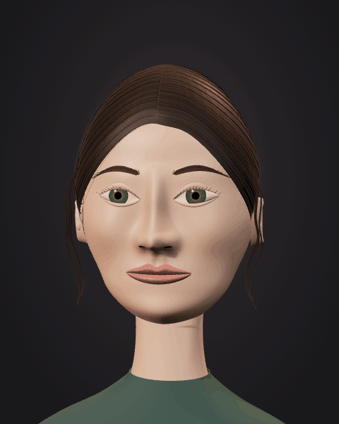 |

[Inspect sadness](http://127.0.0.1:4173/expressions/#sadness) · SVG ancestor: [105197 — Quiet sadness](archive/svg-final/corpus/animated/105197.svg)

### Anger

**Contained anger.** Watch the brows draw down and inward, the eye openings narrow and the lips press. The challenge is readable tension without pinching the cheek or breaking the lip silhouette.

| Current shared character | Procedural predecessor |
| --- | --- |
|  |  |

[Inspect anger](http://127.0.0.1:4173/expressions/#anger) · SVG ancestor: [105198 — Contained anger](archive/svg-final/corpus/animated/105198.svg)

### Fear

**A moment of fear.** Watch the raised brows and widened eyes combine with stretched lips and a restrained jaw opening. This study exposes dental placement: the teeth must stay inside the moving lips and the tongue must remain recessed.

| Current shared character | Procedural predecessor |
| --- | --- |
|  |  |

[Inspect fear](http://127.0.0.1:4173/expressions/#fear) · SVG ancestor: [105199 — A moment of fear](archive/svg-final/corpus/animated/105199.svg)

### Surprise

**Open wonder.** Watch both brows lift, the eyelids open and the lips round around a modest jaw release. In profile, the chin, lower lip and oral surfaces must move together. Surprise became a useful close-up test for the teeth, complexion and mouth depth repairs.

| Current shared character | Procedural predecessor |
| --- | --- |
|  | 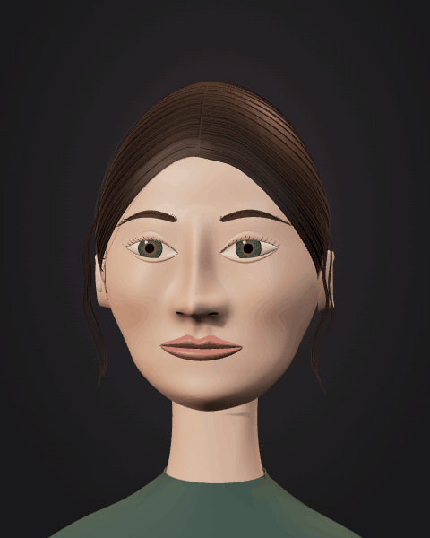 |

[Inspect surprise](http://127.0.0.1:4173/expressions/#surprise) · SVG ancestor: [105200 — Open surprise](archive/svg-final/corpus/animated/105200.svg)

### Disgust

**A passing distaste.** Watch one side of the upper lip lift with the nose while the eyes and brows tighten briefly. The asymmetry distinguishes this fleeting recoil from anger.

| Current shared character | Procedural predecessor |
| --- | --- |
| 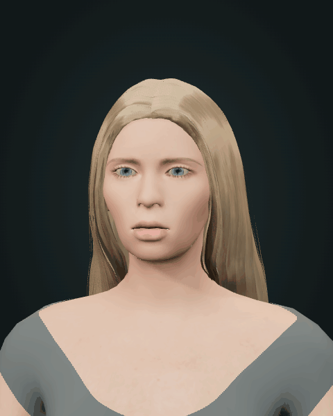 |  |

[Inspect disgust](http://127.0.0.1:4173/expressions/#disgust). Disgust belongs to the eight-expression Three.js collection; **there is no corresponding SVG expression in the archived corpus**.

### Wink

**A knowing wink.** Watch the viewer-left eyelid close over its iris while the opposite eye remains open. The same-side cheek rises into a small asymmetric smile; the closed eye reopens before the face recovers.

| Current shared character | Procedural predecessor |
| --- | --- |
|  | 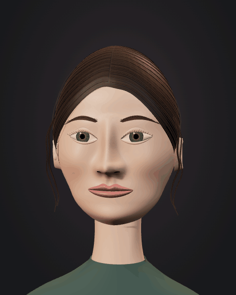 |

[Inspect wink](http://127.0.0.1:4173/expressions/#wink) · SVG ancestor: [105203 — A knowing wink](archive/svg-final/corpus/animated/105203.svg)

### Laughter

**Uncontained delight.** Watch the cheeks lift and eyes narrow as the jaw releases into an open smile. The restrained head lift supports the expression. The cheek highlight and dental exposure made this the clearest test of the combined-pose normal and mouth repairs.

| Current shared character | Procedural predecessor |
| --- | --- |
|  |  |

[Inspect laughter](http://127.0.0.1:4173/expressions/#laughter) · SVG ancestor: [105202 — Laughter in profile](archive/svg-final/corpus/animated/105202.svg)

## The seven SVG expression studies

These previews render the **final accepted native SVG edition**, which replaced tiny whole-head inclinations with visible local facial movement. The same source IDs also exist in the initial vector, raster and earlier Hairline editions. Those predecessors are linked below for comparison; the animated previews do not silently substitute one edition for another.

| Five-second final SVG preview | Action and earlier editions |
| --- | --- |
| 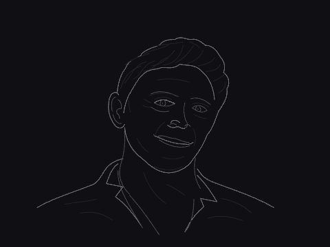 | **105196 · A quiet smile.** The smile releases, broadens with lifted cheeks and an opening mouth, then returns; both eyes blink. [Final SVG](archive/svg-final/corpus/animated/105196.svg) · [Initial vector](archive/vector-v1/corpus/animated/105196.svg) · [Raster study](archive/raster-v2/corpus/animated/105196.html) · [Earlier Hairline](archive/hairline-v3/corpus/animated/105196.svg) |
| 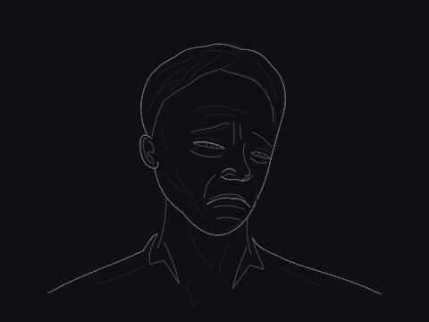 | **105197 · Quiet sadness.** The inner brows lift, lids droop and mouth corners lower together after a brief relaxation. [Final SVG](archive/svg-final/corpus/animated/105197.svg) · [Initial vector](archive/vector-v1/corpus/animated/105197.svg) · [Raster study](archive/raster-v2/corpus/animated/105197.html) · [Earlier Hairline](archive/hairline-v3/corpus/animated/105197.svg) |
| 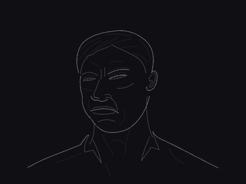 | **105198 · Contained anger.** Brows and lips release, then the brows converge, the eyes narrow and the lips press. [Final SVG](archive/svg-final/corpus/animated/105198.svg) · [Initial vector](archive/vector-v1/corpus/animated/105198.svg) · [Raster study](archive/raster-v2/corpus/animated/105198.html) · [Earlier Hairline](archive/hairline-v3/corpus/animated/105198.svg) |
| 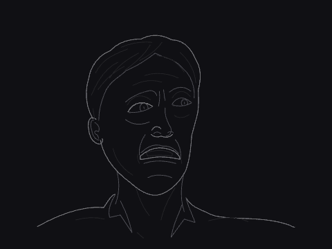 | **105199 · A moment of fear.** Eyes widen, inner brows rise, the mouth retracts and the jaw drops from a calmer pose. [Final SVG](archive/svg-final/corpus/animated/105199.svg) · [Initial vector](archive/vector-v1/corpus/animated/105199.svg) · [Raster study](archive/raster-v2/corpus/animated/105199.html) · [Earlier Hairline](archive/hairline-v3/corpus/animated/105199.svg) |
| 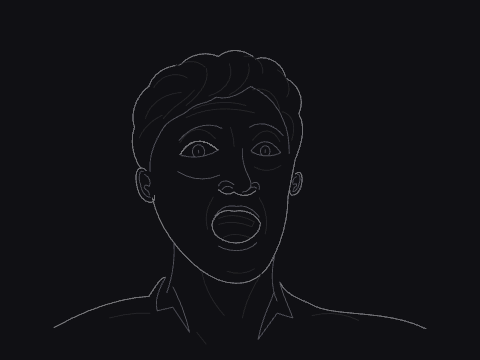 | **105200 · Open surprise.** The mouth closes and brows settle before a visible gasp raises the brows, widens the eyes and releases the jaw. [Final SVG](archive/svg-final/corpus/animated/105200.svg) · [Initial vector](archive/vector-v1/corpus/animated/105200.svg) · [Raster study](archive/raster-v2/corpus/animated/105200.html) · [Earlier Hairline](archive/hairline-v3/corpus/animated/105200.svg) |
| 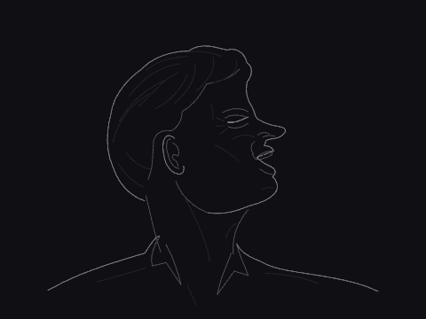 | **105202 · Laughter in profile.** A closed mouth and open eye return to an open jaw, raised cheek and squeezed eyelid. [Final SVG](archive/svg-final/corpus/animated/105202.svg) · [Initial vector](archive/vector-v1/corpus/animated/105202.svg) · [Raster study](archive/raster-v2/corpus/animated/105202.html) · [Earlier Hairline](archive/hairline-v3/corpus/animated/105202.svg) |
| 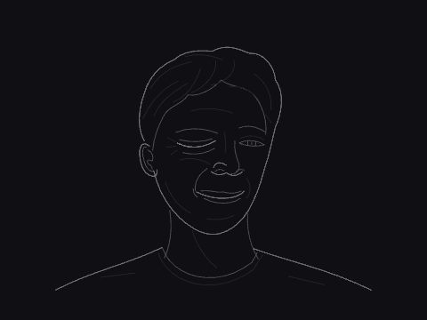 | **105203 · A knowing wink.** The eye opens, makes two winks with a cheek lift, then returns; its iris disappears behind the closed lid. [Final SVG](archive/svg-final/corpus/animated/105203.svg) · [Initial vector](archive/vector-v1/corpus/animated/105203.svg) · [Raster study](archive/raster-v2/corpus/animated/105203.html) · [Earlier Hairline](archive/hairline-v3/corpus/animated/105203.svg) |

The early vector and Hairline sources retain seven-second timing. The final five-second pass is recorded in `d73c45d`; its files are preserved in [archive/svg-final](archive/svg-final/README.md). Some early loops emphasize lighting or a held pose, which is why their appearance alone was insufficient evidence of facial acting.

## Three anatomical foundations

These are head-structure demonstrations, **not three additional emotions**. They establish the jaw hinge, eyelid aperture and ear attachment that the expression studies depend on.

| Final SVG preview | What the experiment demonstrates |
| --- | --- |
| 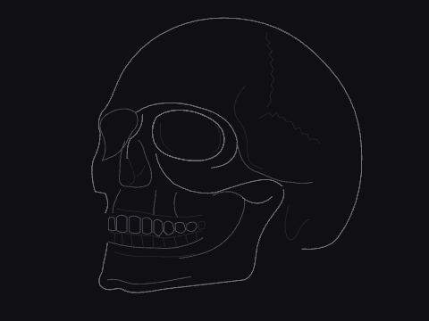 | **105193 · Three-quarter skull.** The mandible opens at its hinge, closes, makes a smaller opening and returns. [Final SVG](archive/svg-final/corpus/animated/105193.svg) · [Initial vector](archive/vector-v1/corpus/animated/105193.svg) · [Raster](archive/raster-v2/corpus/animated/105193.html) · [Earlier Hairline](archive/hairline-v3/corpus/animated/105193.svg) |
| 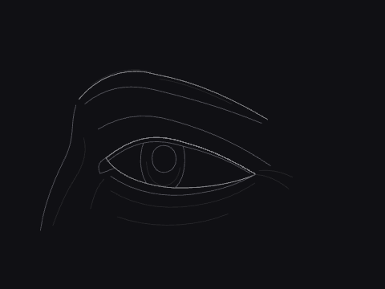 | **105194 · Eye and eyelid structure.** A lateral glance and full blinks test whether the pupil remains behind the moving lid aperture. [Final SVG](archive/svg-final/corpus/animated/105194.svg) · [Initial vector](archive/vector-v1/corpus/animated/105194.svg) · [Raster](archive/raster-v2/corpus/animated/105194.html) · [Earlier Hairline](archive/hairline-v3/corpus/animated/105194.svg) |
| 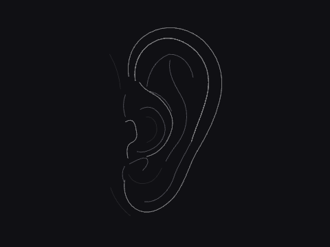 | **105195 · Auricle and concha.** A pinna-flex demonstration folds the outer ear toward its fixed attachment and rebounds. It does not imply ordinary voluntary ear articulation. [Final SVG](archive/svg-final/corpus/animated/105195.svg) · [Initial vector](archive/vector-v1/corpus/animated/105195.svg) · [Raster](archive/raster-v2/corpus/animated/105195.html) · [Earlier Hairline](archive/hairline-v3/corpus/animated/105195.svg) |

## How the portrait changed

| Recorded stage | What changed, and why it mattered |
| --- | --- |
| `f31a9f1` · Initial recorded collection | Vector, raster and Hairline editions were already present. Their preserved source IDs show experiments with line, tone and detail; this commit does not date each experiment separately. |
| `d73c45d` · Visible SVG acting | All 24 corpus loops, including the seven expressions and three head studies above, gained coordinated five-second motion. |
| `6ee937f` → `fb4f100` · Procedural MUSE | Eight facial studies became a separate Three.js viewer. Additional facial detail and studio lighting improved parts, while the constructed surface still limited the portrait. |
| `53763f4` · Shared skinned identity | FORM and MUSE adopted one licensed CC0 adult character with continuous topology, skin weights, facial targets and attached accessories. |
| `2312349` · Lower-face and dental fit | Local jaw/chin refinement and a dental adapter addressed the lower-face silhouette and tooth proportions. |
| `6b21c15` · Complexion, mouth and normals | Albedo isolation identified broad gray/green complexion patches. Softer fill, restrained contour changes, dental/gingival placement, a recessed tongue and combined-pose facial normals addressed separate visible defects. |


*Actual committed browser captures from `6b21c15`; the earlier runtime remains in [skinned-v5-before-complexion](archive/skinned-v5-before-complexion/README.md). The comparison combines contour, material and lighting changes. It is not an isolation test of any one change.*


*Actual committed captures from `6b21c15`. The first two rows show the integrated mouth repair; the last compares identical posed geometry with different normal evaluation. Original commits, paths, image hashes and crops are recorded in the [collage provenance manifest](docs/study/sources.json).*

The durable lesson was to review a face at least **450 pixels high**, then isolate color, geometry, lighting and normals before editing. Enlarging a thumbnail exposed faults that the original gallery view concealed. Detailed repair prompts and the broader chronology are in [README-STUDY.md](README-STUDY.md).

## Continue the expression collection

Use the repository's [muse-expression skill](.agents/skills/muse-expression/SKILL.md) to add a performance while keeping the accepted character and earlier studies intact:

```text
$muse-expression
Read AGENTS.md and inspect the current MUSE implementation. Add a new
five-second expression called "relief": soften the inner brows, release the
lids and jaw, then allow a restrained smile before returning to neutral.
Reuse the shared licensed adult identity and available facial targets.
Coordinate cheeks, lips and lids; keep teeth, tongue, lashes and brows attached.
Preserve selection overlays, labels, OrbitControls and guided-camera behavior.

Register the study, route, metadata and generated catalog together. Extend
validation coverage to the new ID. Inspect neutral, peak and recovery from
front, profile and three-quarter views, with the actual browser face at least
450 pixels high. Check real playback, exact five-second closure, reverse
seeking, mobile framing and mouth clipping. Record what changed and remaining
limits. Leave archive/ and all accepted historical evidence unchanged.
```

The prompt is a reusable extension brief, not a transcript of a historical request. For a separate themed collection, use [muse-form-lab](.agents/skills/muse-form-lab/SKILL.md) and an isolated `experiments/<slug>/` directory.

## Sources and review limits

The [current expression manifest](expressions/manifest.json) supplies titles, beats and SVG mappings; [character-face.mjs](expressions/character-face.mjs) implements the current performance adapter. The [procedural manifest](archive/procedural-v3/expressions/manifest.json) and [archived source](archive/procedural-v3/expressions/) identify the comparison edition. The [final SVG manifest](archive/svg-final/corpus/manifest.json) records each drawing's exact action. [Character permissions and provenance](three/character/assets/README.md) document the shared asset.

The animated previews show rendered, sampled movement; the [preview review](docs/study/animated/review.json) records their durations and sampled-image checks. GIF color quantization and their small display size make them unsuitable for approving subtle complexion, normals or teeth. The portrait collages retain historical evidence; they are not newly executed QA. Inspect the live viewer and relevant checks before accepting a future character change. The character remains a stylized realtime study, not a clinical anatomy model or an exact likeness of a real person.

The [capture script](docs/study/render-animations.mjs) and [GIF encoder](docs/study/encode-animations.py) reproduce the previews with Chrome/Chromium and Python with Pillow. Each loop samples 50 poses at 10 frames per second with a fixed camera and hidden interface overlays. The current portrait uses a tighter camera zoom for readability; its geometry, materials and lighting are unchanged. Archived source files remain untouched.

[Product README](README.md) · [Complete development story](README-STUDY.md) · [Body-movement study](README-STUDY-MUSE.md) · [Current MUSE catalog](expressions/README.md)
