# MUSE study — Body movement

**Project READMEs:** [Overview](README.md) · [Development study](README-STUDY.md) · [Body movement](README-STUDY-MUSE.md) · [Facial expressions](README-STUDY-FORM.md)

**The animated body studies, from articulated drawings to one connected, skinned character.** This document collects all five current movement studies, their procedural predecessors and the ten anatomy drawings that informed them.

**Naming note:** this file uses the requested `README-STUDY-MUSE.md` name for body movement. The application itself remains **FORM** (`three/`); [README-STUDY-FORM.md](README-STUDY-FORM.md) collects facial expressions from MUSE (`expressions/`).

[Current FORM catalog](three/README.md)

## Contents

- [Watch and inspect](#watch-and-inspect)
- [Five movements in three dimensions](#five-movements-in-three-dimensions)
  - [Full body — Reach and return](#full-body--reach-and-return)
  - [Arm — Elbow flexion](#arm--elbow-flexion)
  - [Hand — Opposition, flexion and release](#hand--opposition-flexion-and-release)
  - [Leg — Load and recover](#leg--load-and-recover)
  - [Foot — Rise and settle](#foot--rise-and-settle)
- [Ten drawings in motion](#ten-drawings-in-motion)
- [Compare the earlier editions](#compare-the-earlier-editions)
- [What changed along the way](#what-changed-along-the-way)
- [Continue the collection](#continue-the-collection)
- [Sources and capture limits](#sources-and-capture-limits)

## Watch and inspect

The embedded GIFs repeat a five-second action. They are deterministic time samples of the original browser rendering, useful for seeing the action inside Markdown. They are **not an independent live-playback test**. For orbit, pause, scrubbing and surface selection, run the actual viewer:

```sh
npm ci
npm start
```

Open [FORM](http://127.0.0.1:4173/three/#body). Each study below links to its own view. The GIF capture settings and source paths are recorded in [sources.json](docs/study/animated/sources.json). No MP4 is needed.

## Five movements in three dimensions

The left column shows the current shared character. The right shows the earlier [procedural edition](archive/procedural-v3/README.md). These are different modeling systems, not a controlled comparison of one isolated repair. The current studies use a licensed skinned GLB, continuous surface topology and deterministic joint motion; the earlier edition exposes more of its geometric construction.

### Full body — Reach and return

| Current shared character | Earlier procedural study |
| --- | --- |
| 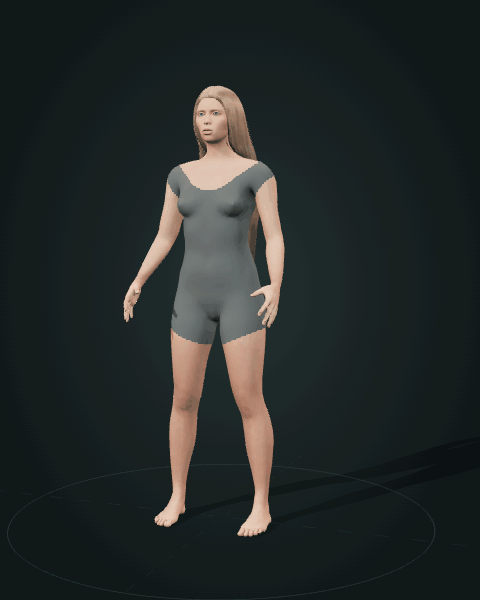 | 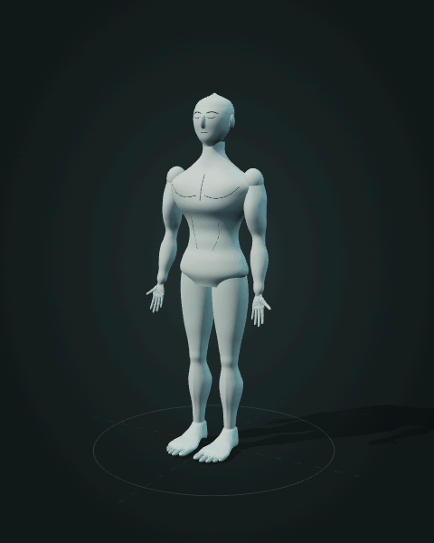 |

**Watch:** the clavicle, shoulder, elbow, wrist and fingers contribute to one reach. The trunk counter-turns and the head follows the gesture while the feet support the body. The release should recover the resting silhouette without a snap.

Select **Pectoralis region**, **Back** or **Pelvis** to follow their surface during the action. The back selection fades the hair so that the region remains visible. These are illustrative surface regions, not exposed or measured muscles.

[Open full-body study](http://127.0.0.1:4173/three/#body) · Drawing references: [105214](archive/svg-final/corpus/animated/105214.svg), [105215](archive/svg-final/corpus/animated/105215.svg), [105218](archive/svg-final/corpus/animated/105218.svg), [105219](archive/svg-final/corpus/animated/105219.svg).

### Arm — Elbow flexion

| Current shared character | Earlier procedural study |
| --- | --- |
| 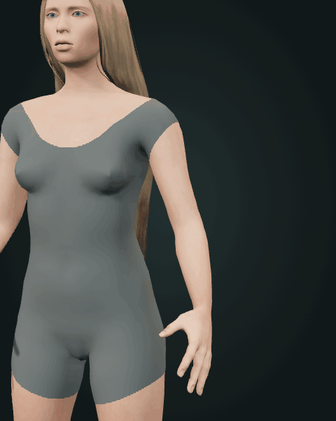 | 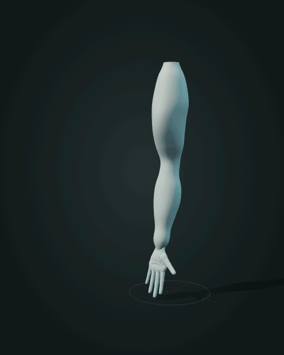 |

**Watch:** the forearm bends at the elbow and carries the wrist and hand with it. The shoulder and upper arm remain connected; the fingers soften into the gesture. Compare the elbow transition at rest, during the bend and at the hold.

Select the **Biceps region**, **Triceps region**, **Deltoid region**, **Forearm** or **Hand & wrist**. The overlay travels with the skin rather than floating above a fixed anatomical diagram.

[Open arm study](http://127.0.0.1:4173/three/#arm) · Drawing reference: [105215](archive/svg-final/corpus/animated/105215.svg).

### Hand — Opposition, flexion and release

| Current shared character | Earlier procedural study |
| --- | --- |
| 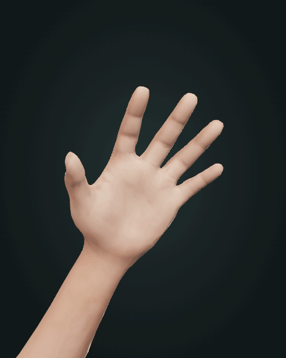 | 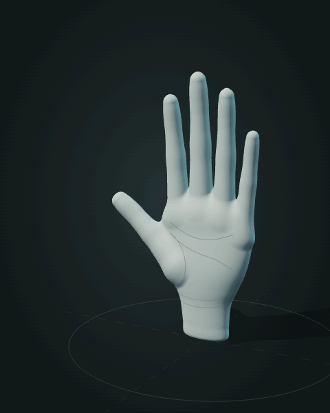 |

**Watch:** the shorter ulnar fingers begin a soft closing wave, each finger bends through its own chain, and the thumb turns toward the palm. Look closely at the little finger's root, the finger webs and the thumb base. They must remain attached through the whole action, including intermediate poses.

The early revisions concentrated on the palm-to-digit transitions and proportion of the fingers. The current version carries the gesture through the shared character's continuous skin. Select the **Little finger**, **Thumb opposition**, **Thenar region**, **Palm** or an individual finger, then orbit to inspect attachment and overlap.

[Open hand study](http://127.0.0.1:4173/three/#hand) · Drawing references: [105216](archive/svg-final/corpus/animated/105216.svg), [105217](archive/svg-final/corpus/animated/105217.svg).

### Leg — Load and recover

| Current shared character | Earlier procedural study |
| --- | --- |
| 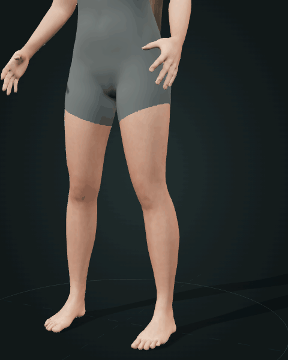 | 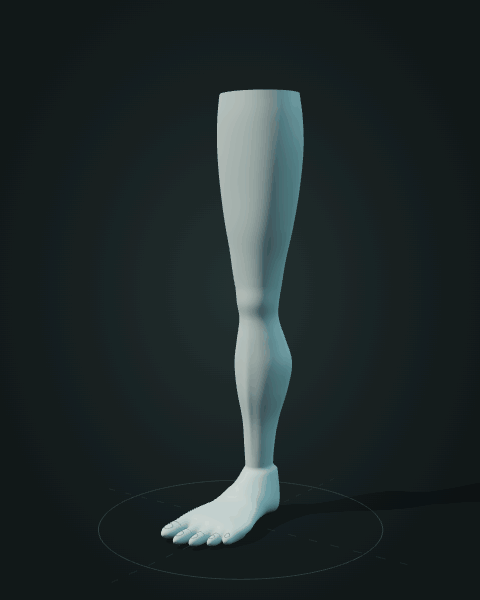 |

**Watch:** the hip, knee and ankle share a shallow bend. The pelvis adjusts to preserve forefoot support. Follow the continuous thigh-to-knee and calf-to-ankle contours rather than judging the movement from the knee angle alone.

Select the **Quadriceps region**, **Hamstring region**, **Knee region** or **Calf region**. A profile view makes support and knee travel easier to inspect; a posterior view reveals the opposite contour.

[Open leg study](http://127.0.0.1:4173/three/#leg) · Drawing references: [105218](archive/svg-final/corpus/animated/105218.svg), [105219](archive/svg-final/corpus/animated/105219.svg), [105220](archive/svg-final/corpus/animated/105220.svg).

### Foot — Rise and settle

| Current shared character | Earlier procedural study |
| --- | --- |
| 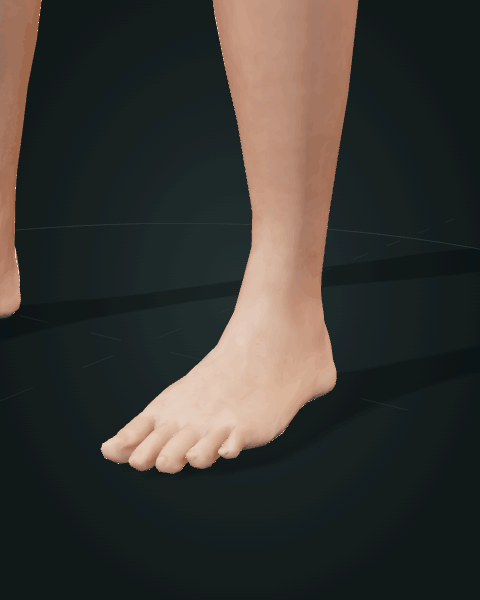 | 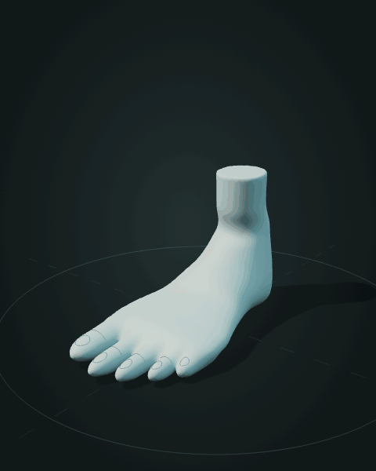 |

**Watch:** the heel rises around the supported forefoot, holds and settles. The ankle, instep and toes remain part of the same surface. Inspect the lateral little toe, the stepped digit lengths and the transition from toe roots into the forefoot.

The earlier lower-limb repair addressed disconnected-looking toes and forefoot continuity. The current study uses the skinned character's connected foot and joint chain. Select **Forefoot & toes**, **Heel**, **Dorsum of foot** or **Ankle region**, then compare medial, lateral and three-quarter views.

[Open foot study](http://127.0.0.1:4173/three/#foot) · Drawing references: [105221](archive/svg-final/corpus/animated/105221.svg), [105222](archive/svg-final/corpus/animated/105222.svg), [105223](archive/svg-final/corpus/animated/105223.svg).

## Ten drawings in motion

These previews show all ten anatomy studies in the **final accepted five-second SVG edition**. Open the linked SVG to inspect the native animated drawing; the GIF is only its Markdown preview. Titles and action descriptions follow the [archived manifest](archive/svg-final/corpus/manifest.json).

| Torso · 105214 | Arm · 105215 |
| --- | --- |
| 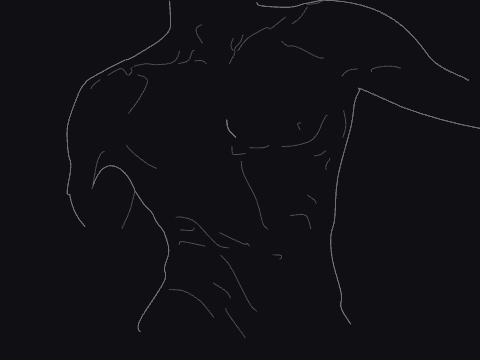 | 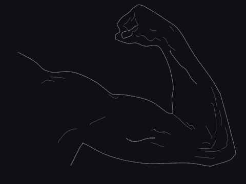 |
| **A Breath Through the Spiral.** The waist stays anchored as the ribcage bends and the opposing chest contours expand. [Animated SVG](archive/svg-final/corpus/animated/105214.svg) · [Still](archive/svg-final/corpus/svg/105214.svg) | **Tension in the Turn.** Elbow flexion carries the fist toward the shoulder; the upper-arm contour gathers and relaxes. [Animated SVG](archive/svg-final/corpus/animated/105215.svg) · [Still](archive/svg-final/corpus/svg/105215.svg) |

| Palm · 105216 | Dorsal hand · 105217 |
| --- | --- |
| 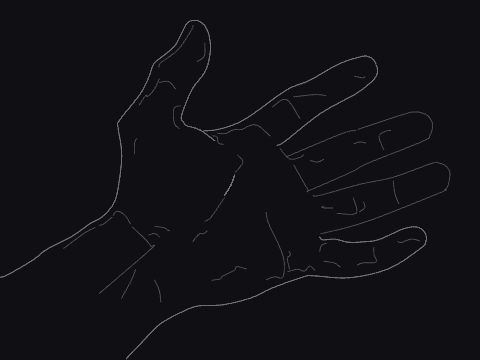 | 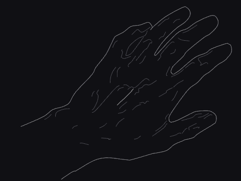 |
| **The Palm Opens.** Despite the title, the authored loop closes the five-digit fan and returns, with an opposing thumb and anchored palm. [Animated SVG](archive/svg-final/corpus/animated/105216.svg) · [Still](archive/svg-final/corpus/svg/105216.svg) | **Tendons Beneath the Gesture.** Fingers spread into a fan, the thumb opens and the dorsal contours tighten above a fixed wrist. [Animated SVG](archive/svg-final/corpus/animated/105217.svg) · [Still](archive/svg-final/corpus/svg/105217.svg) |

| Outer leg · 105218 | Rear leg · 105219 |
| --- | --- |
| 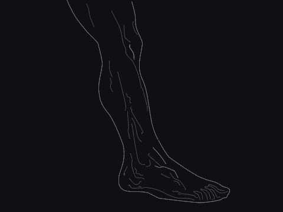 | 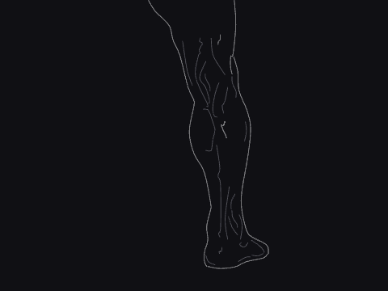 |
| **Weight Through the Outer Leg.** The shin inclines over a planted foot, the thigh counter-rotates and the calf contour changes. [Animated SVG](archive/svg-final/corpus/animated/105218.svg) · [Still](archive/svg-final/corpus/svg/105218.svg) | **The Calf Holds the Weight.** The heel rises around the forefoot; ankle and lower leg follow, then settle. [Animated SVG](archive/svg-final/corpus/animated/105219.svg) · [Still](archive/svg-final/corpus/svg/105219.svg) |

| Bent knee · 105220 | Toe articulation · 105221 |
| --- | --- |
| 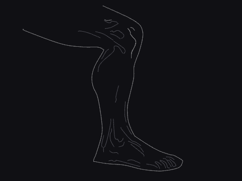 | 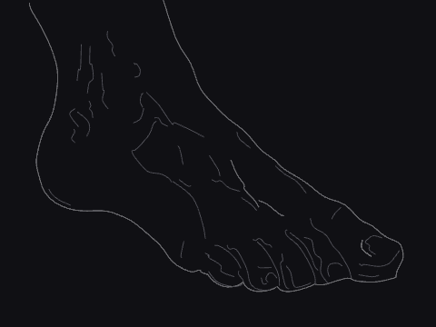 |
| **The Knee Connects the Gesture.** The knee advances over the planted foot through linked ankle and thigh rotation. [Animated SVG](archive/svg-final/corpus/animated/105220.svg) · [Still](archive/svg-final/corpus/svg/105220.svg) | **Five Toes, One Foundation.** The five rays articulate at their forefoot roots, led by the great toe while heel and ankle remain fixed. [Animated SVG](archive/svg-final/corpus/animated/105221.svg) · [Still](archive/svg-final/corpus/svg/105221.svg) |

| Dorsal foot · 105222 | Three-quarter foot · 105223 |
| --- | --- |
| 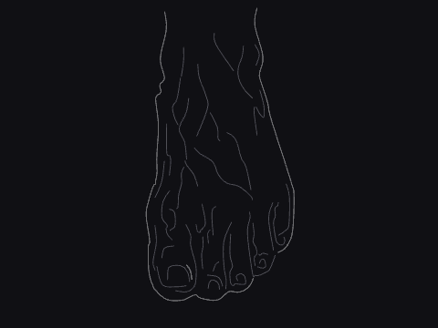 | 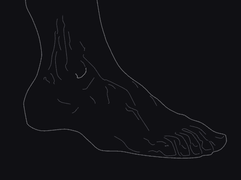 |
| **The Foot Seen from Above.** The toes spread from their metatarsal joints while the ankle and main foot remain anchored. [Animated SVG](archive/svg-final/corpus/animated/105222.svg) · [Still](archive/svg-final/corpus/svg/105222.svg) | **The Foot in Three-Quarter View.** The heel and Achilles rise around the planted ball of the foot while the toes retain support. [Animated SVG](archive/svg-final/corpus/animated/105223.svg) · [Still](archive/svg-final/corpus/svg/105223.svg) |

## Compare the earlier editions

The source IDs let us follow an idea across different media. The first vector, raster and Hairline editions preserve their original **seven-second** timing; the final SVG edition uses **five seconds**. The raster links open their original HTML animations and require the local server. Their restrained deformations and overlay effects explain why later revisions emphasized visibly articulated motion.

| Study ID | Early vector | Raster experiment | Hairline edition | Final animated SVG |
| --- | --- | --- | --- | --- |
| 105214 · torso | [SVG](archive/vector-v1/corpus/animated/105214.svg) | [HTML](archive/raster-v2/corpus/animated/105214.html) | [SVG](archive/hairline-v3/corpus/animated/105214.svg) | [SVG](archive/svg-final/corpus/animated/105214.svg) |
| 105215 · arm | [SVG](archive/vector-v1/corpus/animated/105215.svg) | [HTML](archive/raster-v2/corpus/animated/105215.html) | [SVG](archive/hairline-v3/corpus/animated/105215.svg) | [SVG](archive/svg-final/corpus/animated/105215.svg) |
| 105216 · palm | [SVG](archive/vector-v1/corpus/animated/105216.svg) | [HTML](archive/raster-v2/corpus/animated/105216.html) | [SVG](archive/hairline-v3/corpus/animated/105216.svg) | [SVG](archive/svg-final/corpus/animated/105216.svg) |
| 105217 · dorsal hand | [SVG](archive/vector-v1/corpus/animated/105217.svg) | [HTML](archive/raster-v2/corpus/animated/105217.html) | [SVG](archive/hairline-v3/corpus/animated/105217.svg) | [SVG](archive/svg-final/corpus/animated/105217.svg) |
| 105218 · outer leg | [SVG](archive/vector-v1/corpus/animated/105218.svg) | [HTML](archive/raster-v2/corpus/animated/105218.html) | [SVG](archive/hairline-v3/corpus/animated/105218.svg) | [SVG](archive/svg-final/corpus/animated/105218.svg) |
| 105219 · rear leg | [SVG](archive/vector-v1/corpus/animated/105219.svg) | [HTML](archive/raster-v2/corpus/animated/105219.html) | [SVG](archive/hairline-v3/corpus/animated/105219.svg) | [SVG](archive/svg-final/corpus/animated/105219.svg) |
| 105220 · corrected knee study | [SVG](archive/vector-v1/corpus/animated/105220.svg) | [HTML](archive/raster-v2/corpus/animated/105220.html) | [SVG](archive/hairline-v3/corpus/animated/105220.svg) | [SVG](archive/svg-final/corpus/animated/105220.svg) |
| 105221 · toes | [SVG](archive/vector-v1/corpus/animated/105221.svg) | [HTML](archive/raster-v2/corpus/animated/105221.html) | [SVG](archive/hairline-v3/corpus/animated/105221.svg) | [SVG](archive/svg-final/corpus/animated/105221.svg) |
| 105222 · dorsal foot | [SVG](archive/vector-v1/corpus/animated/105222.svg) | [HTML](archive/raster-v2/corpus/animated/105222.html) | [SVG](archive/hairline-v3/corpus/animated/105222.svg) | [SVG](archive/svg-final/corpus/animated/105222.svg) |
| 105223 · three-quarter foot | [SVG](archive/vector-v1/corpus/animated/105223.svg) | [HTML](archive/raster-v2/corpus/animated/105223.html) | [SVG](archive/hairline-v3/corpus/animated/105223.svg) | [SVG](archive/svg-final/corpus/animated/105223.svg) |

**A source-mapping correction matters:** `105220` was interpreted as an arm in the first vector edition. Later manifests identify the reference as an outer leg and bent knee. Keeping the ID exposes that correction rather than presenting the first version as the same anatomy.

## What changed along the way

| Recorded revision | Movement lesson |
| --- | --- |
| `f31a9f1` · first recorded collection | Vector, raster and Hairline experiments were already present. Their order comes from archived edition notes, not separate dated commits. Richer shading did not make a held drawing articulate. |
| `d73c45d` · five-second SVG revision | Joint-aware local changes replaced movements too subtle to read. Exact returning paths and rest/peak comparisons became part of review. |
| `03e6a29` · first FORM | Five Three.js views introduced orbit, guided camera, anatomical selection and moving labels. |
| `6ee937f` · hand refinement | The hand surface and its connections were revised while MUSE became a separate expression viewer. [Earlier hand source](archive/three-v1/) is retained. |
| `fb4f100` · forefoot refinement | Lower-limb work addressed the toe-to-forefoot transition. The [preceding lower-limb snapshot](archive/three-v2/) preserves the construction before that repair. |
| `53763f4` · shared skinned character | Both viewers moved to continuous licensed human topology and a shared adult identity. Selection overlays began reusing the posed character surface. |
| `2312349` and `6b21c15` · shared appearance refinements | Face, dentition, complexion and lighting changed the identity seen in both apps. They did not introduce additional body movement studies. |

The current five views share one model instead of assembling separate body parts. The ten drawings remain valuable movement references, but there is no claim that each SVG became an identical 3D animation. The [current manifest](three/manifest.json) records the actual reference mapping, actions, selectable regions and authoring prompts.

## Continue the collection

Use the repository's [form-motion skill](.agents/skills/form-motion/SKILL.md) for a new action or repair. Use [muse-form-lab](.agents/skills/muse-form-lab/SKILL.md) for a separate experimental set. These are reusable prompts for future work, not verbatim historical prompts.

```text
$form-motion
Read AGENTS.md and inspect the current body, hand and foot studies before editing.
Add a five-second “Reach, offer, return” study on the same skinned adult character.
Coordinate clavicle, shoulder, elbow, wrist, fingers and a small trunk response.
Keep both feet supported and the little finger rooted in the palm. Preserve all
existing study IDs, OrbitControls, guided-camera interruption and selections.
Use surface-following mint highlights and anchors. Derive the whole pose from
absolute time after restoring rest; match the exact 0/5-second endpoints.
Extend navigation, metadata, catalog and validation coverage. Inspect front,
profile and three-quarter views, intermediate poses, contacts, reverse seeking,
actual playback and mobile framing. Record concrete defects and repair them.
```

```text
$muse-form-lab
Create an experiment in experiments/support-and-gesture/ comparing three actions:
supported knee loading, heel rise and an open-hand offer. Use the current licensed
character and shared runtime; do not change accepted studies or archive files.
Give each action a five-second deterministic loop, explanatory surface selections
and a brief note on support, joint coordination and silhouette. Capture matched
rest, transition and peak views plus an animated browser preview. Compare the
results with the relevant archived SVGs, documenting what improved and what
remains stylized. Provide source paths, prompts and the scope of actual review.
```

## Sources and capture limits

The body studies are implemented in [anatomy.mjs](three/character/anatomy.mjs), with shared character loading in [character.mjs](three/character/character.mjs), surface selections in [regions.mjs](three/character/regions.mjs), the movement envelope in [geometry.mjs](three/geometry.mjs) and playback transport in [motion.mjs](three/runtime/motion.mjs). [Asset provenance](three/character/assets/README.md) records the licensed inputs. The [procedural manifest](archive/procedural-v3/three/manifest.json) and [final SVG manifest](archive/svg-final/corpus/manifest.json) describe the earlier studies.

The GIFs are real rendered samples, not concept illustrations. See [capture provenance](docs/study/animated/sources.json) for their source edition, paths, framing and time samples, and the [preview review](docs/study/animated/review.json) for duration and sampled-image checks. A short preview cannot certify anatomical accuracy, all intermediate poses or real-time performance; the linked viewers and preserved [QA records](archive/qa-records-before-cleanup/README.md) supply the inspectable context. These studies are artistic references, not clinical simulations.

The [capture script](docs/study/render-animations.mjs) and [GIF encoder](docs/study/encode-animations.py) reproduce the previews with Chrome/Chromium and Python with Pillow. They render 50 samples at 10 frames per second, using a fixed camera and hiding interface overlays only in the capture page. The procedural bundle is extracted to a temporary directory; the archive is not modified.
