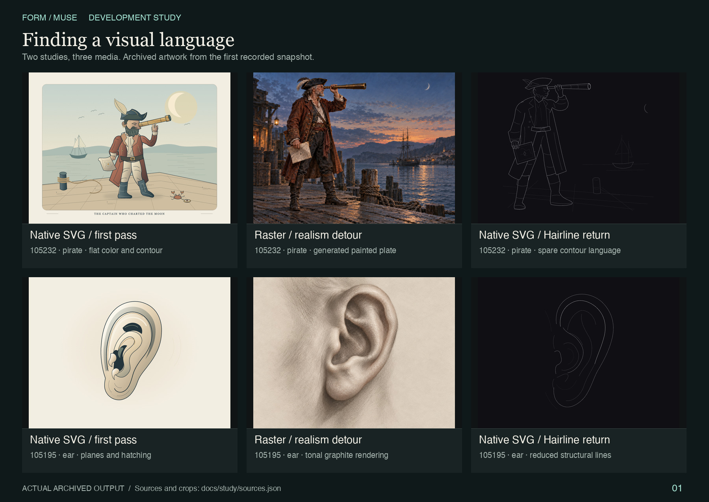
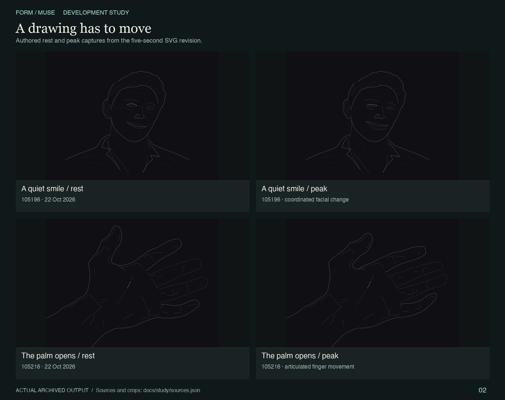
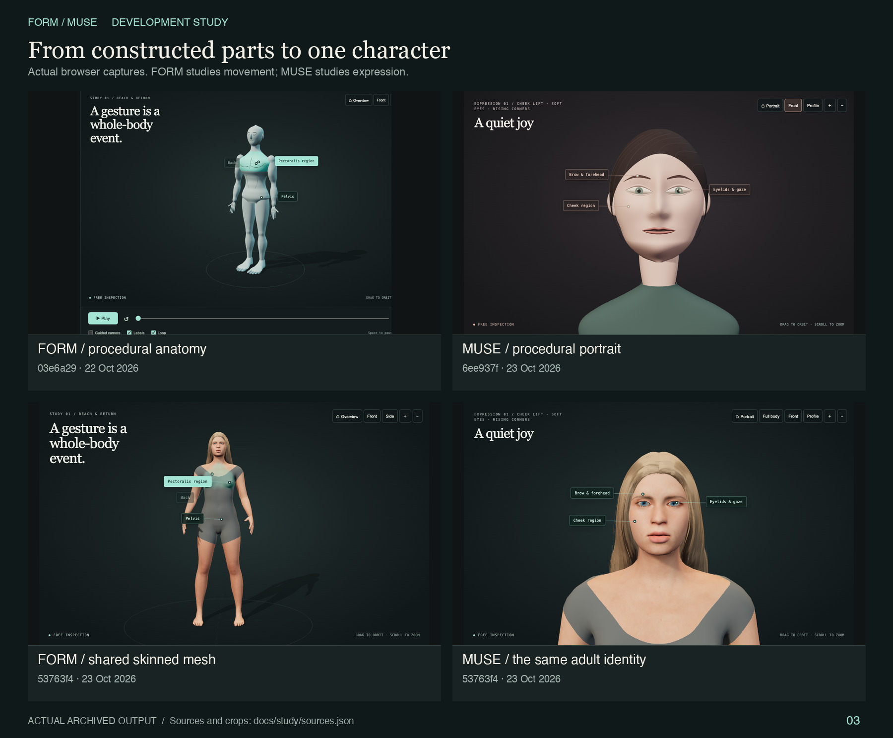
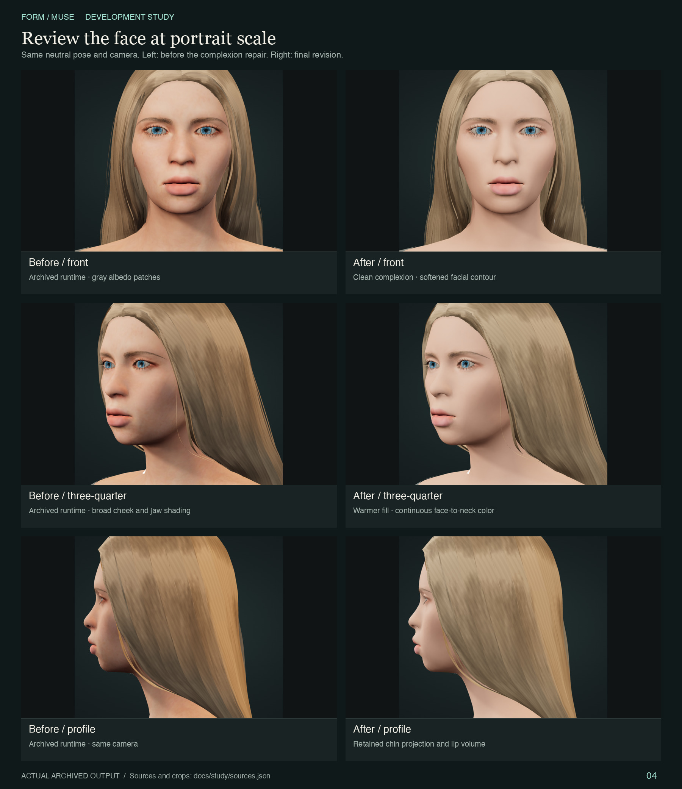
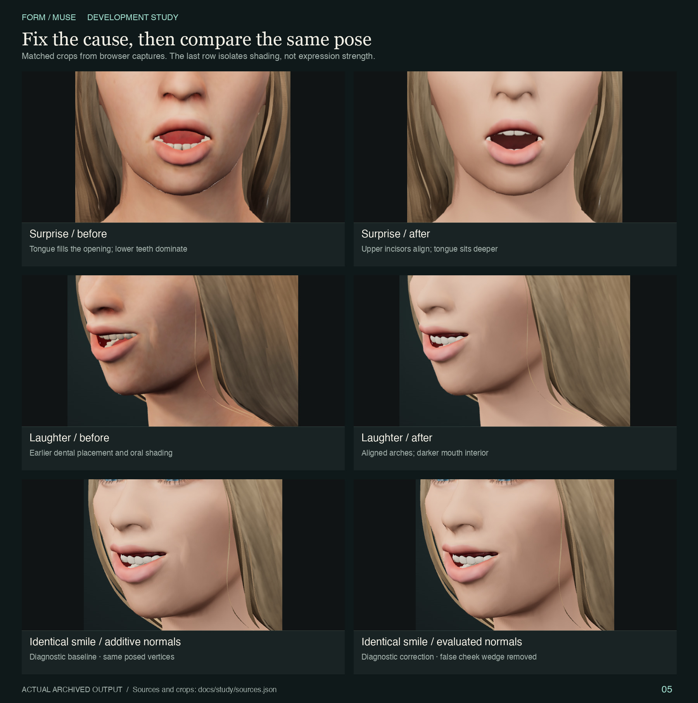

# FORM / MUSE — Development study

**Project READMEs:** [Overview](README.md) · [Development study](README-STUDY.md) · [Body movement](README-STUDY-MUSE.md) · [Facial expressions](README-STUDY-FORM.md)

**From drawings that barely moved to a shared, interactive human character.** This is the visual record of the experiments, rejected shortcuts and repairs behind FORM and MUSE. The [main README](README.md) describes the current product; this document explains how it got there.

Explore the complete animated catalogs in [the body-movement study](README-STUDY-MUSE.md) and [the facial-expression study](README-STUDY-FORM.md), including current/procedural comparisons and the earlier native SVG actions. Their filenames follow the requested labels; the actual viewers retain their existing names.

The recorded Git history spans **22–23 October 2026**. Its commit messages are mostly generic, so the milestones below are reconstructed from file additions, diffs, archived READMEs and saved renders. The earliest commit already contains three earlier editions. Their sequence is documented in the archives; they do not have separate dated commits in this repository.

The prompts below are **reusable reconstructions of the goals and repair methods**, not verbatim historical conversations or evidence that one exact prompt caused a commit. Use the installed `$seven-second-storytelling` skill when available; its historical name remains, but motion lasts **five seconds**. Otherwise, use a repository coding agent that reads [AGENTS.md](AGENTS.md) and inspects the actual implementation before editing. Historical SVG and procedural experiments belong in a separate working study directory or branch; treat `archive/` as immutable reference.

For new work on the current applications, the [MUSE, FORM and experiment skills](README.md#reusable-codex-skills) carry these lessons forward. The prompts below explain the historical repairs; the new skills add current integration points and guidance for extending study coverage.

## 1. Start with the drawing

The first collection contained 24 anatomy, expression and story studies. Native SVG made the shapes editable and the small stories portable. Warm paper, colored planes and hatching established composition, but the result did not yet have the requested realism.

A raster experiment introduced graphite anatomy plates and painted scenes. It supplied richer light, depth and surface detail, but its animation remained a cinemagraph of a held pose. The next pass returned to native SVG and a Hairline-inspired vocabulary: thin contours, quiet interiors, controlled negative space and one focal accent.



*Actual archived plates, recorded together in `f31a9f1`. Study IDs stay constant across the comparison. Sources: [vector-v1](archive/vector-v1/README.md), [raster-v2](archive/raster-v2/README.md), [hairline-v3](archive/hairline-v3/README.md). Colors are unchanged; the subdued line contrast is part of the historical output.*

The lesson was practical: a convincing still and a convincing animation are different deliverables. More rendering detail could not substitute for a readable action.

<details>
<summary>Reusable prompt — compare media without losing the drawing</summary>

```text
Read AGENTS.md. Work in a separate study directory or branch; treat archive/
as immutable reference. Choose one archived anatomy study and one story study,
retaining their source IDs. Compare the native SVG, raster and Hairline editions
at the same composition and crop. Identify which contours establish anatomy,
which tonal details establish depth, and which details are unnecessary.

Create a new native SVG interpretation with clean silhouette, quiet interior
lines, generous negative space and one focal accent. Use actual vector paths;
do not embed a painting or imitate shading with noisy hatching. Preserve the
important proportions, contacts and occlusion. Review the still at full size
and thumbnail size, record concrete defects, and revise before animation.
Keep the reference, new drawing and observations separate and traceable.
```

</details>

## 2. Make the movement visible

The next requirement was specific: preserve the accepted line drawings, shorten the loops to five seconds, and animate expressions, fingers and anatomy rather than relying on tiny whole-image tilts or color pulses. Commit `d73c45d` changes all 24 animated SVGs and adds a dedicated motion-review record.

Matching path geometry and articulated groups made the actions local: a jaw opens beneath a fixed cranium, eyelids and mouth change together, fingers bend around their joints. Rest and peak captures became part of the review, alongside automatic-playback samples and matching loop endpoints. The accepted final SVG collection is retained in [archive/svg-final](archive/svg-final/), separate from the current MUSE and FORM applications.



*Rendered poses from `d73c45d`, studies `105196` and `105216`. These are still samples of the loops, not proof that every intermediate frame is correct.*

<details>
<summary>Reusable prompt — turn a held drawing into a readable five-second action</summary>

```text
Read AGENTS.md. Copy the selected SVG study into a separate working directory
or branch; leave archive/ untouched. Preserve its accepted contour language.
Author one readable five-second action: coordinated eyes, brows, cheeks and
mouth for a face, or joint-aware finger movement for a hand. Keep supporting
contacts and rigid props fixed. Use matching path geometry or articulated
groups; avoid whole-image sway, color pulses and elastic anatomical distortion.

Drive every track from the same absolute time and match the values at 0 and
5 seconds. Compare rest, intermediate and peak poses with an identical crop.
Inspect actual playback across the loop boundary, then seek forward and
backward to the same times. Repair floating contacts, overlaps and implausible
bends. Deliver static and animated native SVGs with a brief review; no MP4.
```

</details>

## 3. Give anatomy another dimension

FORM arrived in `03e6a29` with five Three.js studies: full body, arm, hand, leg and foot. Rotation, feature selection, anchored labels and a guided camera made the studies inspectable. MUSE followed in `6ee937f`, adding eight expressions as a separate view.

The first models were built procedurally. That made joints and motion easy to author, but exposed the construction: spherical shoulders, segmented limbs, a rigid face and disconnected-looking extremities. The hand and forefoot received continuity repairs, and MUSE gained more facial detail and studio lighting in `fb4f100`. Those edits improved individual parts without resolving the overall mannequin silhouette.



*Top: the first FORM and MUSE browser captures. Bottom: the shared-character implementation in `53763f4`, before the later portrait refinements. The [procedural archive](archive/procedural-v3/README.md) preserves that earlier architecture and its runnable bundle.*

The modeling approach changed in `53763f4`: both views began using one licensed, skinned adult character with a shared neutral identity. The source assets provide continuous human topology, skin weights, facial targets and attached accessories. Local adapters drive the studies, fit the neutral bodysuit and maintain surface-conforming selection regions. [Asset provenance and license evidence](three/character/assets/README.md) distinguish the CC0 asset data from the upstream generator code, which was not imported.

<details>
<summary>Reusable prompt — replace the mannequin while keeping the interactions</summary>

```text
Read AGENTS.md and the FORM/MUSE source notes. Inspect the actual current scenes.
If reproducing the procedural experiment, use a separate study directory or
branch and keep archive/ immutable. For the application improvement, replace
segmented primitive anatomy with a properly licensed skinned GLB character.
Record asset-specific permission and provenance; do not import incompatible
upstream generator code. Share one fixed adult identity and neutral pose between
FORM and MUSE, with independent cloned skeletons and material instances.

Preserve the five-second motion, OrbitControls, guided-camera interruption,
selection and responsiveness. Fit mint highlights to the animated surface and
anchor labels to the posed mesh. Review fingers, shoulders, hips and feet at
matched rest, intermediate and peak times from front, profile and three-quarter
views. Check visible motion and contacts, moving anchors, mobile framing and
exact loop closure using evaluated skin vertices, morphs and bone matrices.
```

</details>

## 4. A close-up changes the quality bar

A small gallery image concealed problems that were obvious at portrait scale. The first skinned face still had an overly strong lower-face impression, gray photographic patches in its complexion and a mouth that looked assembled incorrectly.

Commit `2312349` introduced a restrained jaw/chin contour and a dental adapter. The following revision, `6b21c15`, went deeper: separate the source of a defect before adjusting the whole face. Disabling normal detail did little to the beard-like appearance; isolating albedo exposed broad gray/green color patches. The repair reduced those broad patches while retaining subdued fine detail, lip pigment and lid margins. Softer neutral-warm fill and small brow, nasal and cheek adjustments completed the change.



*Matched enlarged browser captures saved in `6b21c15`. The left column loads the runtime preserved in [skinned-v5-before-complexion](archive/skinned-v5-before-complexion/README.md); the right shows the final revision. These comparisons include contour, material and lighting changes together.*

The review rule changed with the work: inspect a face at least 450 pixels high, then check front, profile and three-quarter views. A thumbnail can organize a collection; it cannot approve teeth, skin texture or cheek shading.

<details>
<summary>Reusable prompt — refine complexion and facial shape through isolation tests</summary>

```text
Read AGENTS.md. Capture the current face at least 450 pixels high from front,
profile and three-quarter views. Keep identity, expression time, camera and
exposure fixed for each before/after pair. Diagnose gray mottling separately:
compare normal detail disabled, albedo disabled and the original material.
Do not assume a lighting or geometry change will fix baked texture patches.

If albedo is responsible, suppress broad gray/green variation while retaining
subtle fine detail, lip pigment, eyelid margins and continuous neck color.
Then tune soft neutral-warm studio fill without flattening the facial planes.
Make restrained brow, nasal, cheek and jaw adjustments only where the matched
views support them; carry attached accessories and morph displacements through
the same deformation. Preserve eye spacing, lip volume and chin projection.
Recheck neutral, surprise and laughter enlarged in all three views. Report
which material, light or geometry change addresses each observed defect.
```

</details>

## 5. Diagnose the mouth and the light

Three separate faults were producing one unconvincing smile. The upper dental edge sat too high behind the lip, the tongue occupied too much of the visible opening, and combining facial morph normals created a false triangular cheek highlight.

The final repair moved both dental arches and their gingiva together, recessed the tongue into the mouth floor and refined enamel color and oral depth shading. The cheek artifact required a different fix: evaluate normals from the combined facial pose while preserving the authored neutral. The smile geometry did not need to be weakened.



*Committed diagnostic captures from `6b21c15`. The first two rows show the integrated repair; the last isolates the normal calculation on identical posed vertices. This distinction prevents a material change from being credited for a geometry or shading repair it did not make.*

<details>
<summary>Reusable prompt — repair teeth, tongue depth and smile shading at their source</summary>

```text
Read AGENTS.md. Freeze camera, expression weights and time for comparison.
Inspect enlarged neutral, surprise, fear and laughter from front, profile and
three-quarter views. Isolate body, teeth and tongue meshes before editing.
If the upper teeth hide above the lip while lower crowns dominate, fit both
arches and gingiva together; preserve their bite, attachment and morph targets.
If the tongue fills the aperture, recess and lower it into the oral floor.
Use restrained ivory enamel and oral depth shading only after the fit is sound.

For a triangular cheek highlight, compare additive morph normals with normals
computed from the exact same combined posed vertices. If that removes it,
repair the normal evaluation rather than weakening the smile or repainting
skin. Preserve authored neutral normals and use private per-instance buffers;
avoid repeated allocation and update only when the pose changes. Recheck all
eight expressions, independent FORM/MUSE instances, five-second closure,
reverse seeking, mobile performance and clipping. Save matched crops and label
geometry, material and normal fixes separately, including remaining limits.
```

</details>

## The recorded milestones

| Commit | Date | Evidence in the changed files |
|---|---|---|
| `f31a9f1` | 22 Oct 2026 | Initial recorded collection; vector, raster and Hairline archives already present. |
| `d73c45d` | 22 Oct 2026 | All 24 SVG loops revised; five-second motion QA added. |
| `03e6a29` | 22 Oct 2026 | FORM application, five anatomy studies and Three.js review added. |
| `6ee937f` | 23 Oct 2026 | MUSE added; hand surface revised; first FORM source archived. |
| `fb4f100` | 23 Oct 2026 | Procedural facial/detail/studio revision and forefoot continuity repair. |
| `53763f4` | 23 Oct 2026 | Shared licensed skinned character and expression adapter added; procedural edition archived. |
| `2312349` | 23 Oct 2026 | Local facial contour and dentition modules added; prior character snapshot retained. |
| `6b21c15` | 23 Oct 2026 | Complexion, light, oral assembly and combined-pose facial-normal repairs; enlarged QA added. |

These dates are repository commit dates, not a claim that every underlying experiment began or ended at that moment. Inspect a milestone with `git show --stat <commit>`; examine its exact changes with `git show <commit> -- <path>`.

## What the experiments established

The useful unit of progress was a reproducible comparison: same identity, pose, time and camera. Separating material, geometry and lighting faults led to more precise repairs. One shared character also made FORM and MUSE easier to keep consistent than two independently constructed models.

The current result remains a stylized realtime character, not a photographic digital double or a medically validated anatomical atlas. Textured hair, simplified oral lighting and authored acting poses have visible limits. Deterministic timing, endpoint checks and selection tests establish behavior; they do not certify anatomy or artistic quality. The retained archives make those tradeoffs inspectable instead of hiding them behind a final screenshot. Historical review records also remain in [archive/qa-records-before-cleanup](archive/qa-records-before-cleanup/).

All five collages use actual committed artwork or browser captures. They were cropped, proportionally scaled and labeled without recoloring or generative replacement. [The source manifest](docs/study/sources.json) records full commit IDs, original paths, image hashes and crop coordinates. [The collage builder](docs/study/build-collages.py) reads pinned Git blobs, so the documentation remains reproducible after old working files are removed. It requires Pillow and the full Git history.
