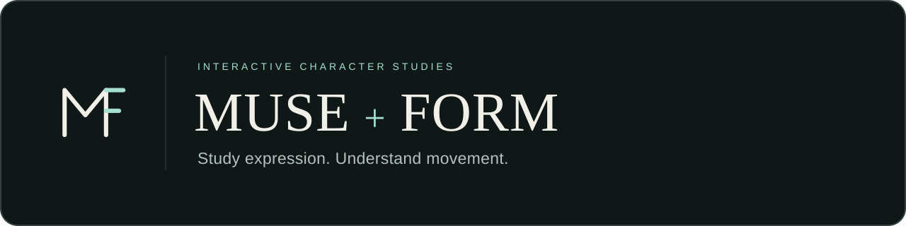
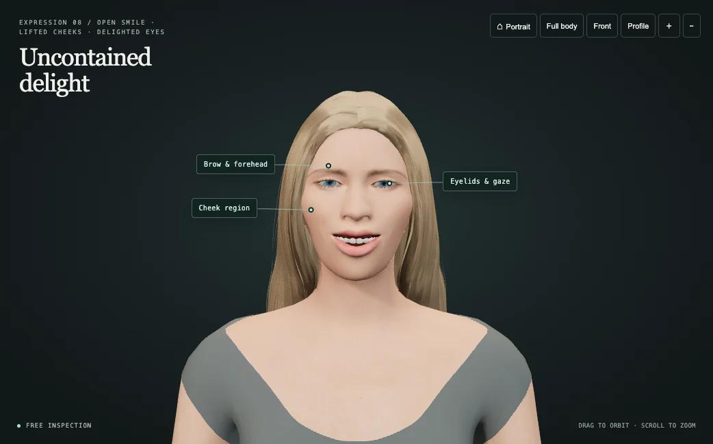
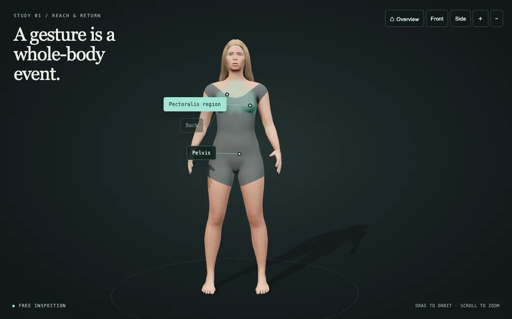

<p align="center">
  
</p>

**Interactive 3D references for artists learning how faces express and bodies move.**

MUSE + FORM turns a reference pose into something you can investigate. Play a five-second movement, stop at any moment, orbit the character, and select a surface to follow its shape. Two focused viewers share one adult character, so the face and body remain consistent across studies.

**Project READMEs:** [Overview](README.md) · [Development study](README-STUDY.md) · [Body movement](README-STUDY-MUSE.md) · [Facial expressions](README-STUDY-FORM.md)

[Run locally](#run-locally) · [MUSE expressions](expressions/README.md) · [FORM anatomy](three/README.md)

**Try it online:** [Project home](https://josoroma.github.io/Muse-Form/) · [Open MUSE](https://josoroma.github.io/Muse-Form/expressions/) · [Open FORM](https://josoroma.github.io/Muse-Form/three/)

The animated study filenames follow the requested labels: `README-STUDY-MUSE.md` covers body movement and `README-STUDY-FORM.md` covers facial expressions. The application names remain FORM for anatomy and MUSE for expression.

| MUSE · facial expression | FORM · anatomy in motion |
| --- | --- |
|  |  |

## Table of contents

- [The problem](#the-problem)
- [The product today](#the-product-today)
- [Who it is for](#who-it-is-for)
- [Run locally](#run-locally)
- [Publish with GitHub Pages](#publish-with-github-pages)
- [Reusable Codex skills](#reusable-codex-skills)
- [Prompts for our skill or coding agent](#prompts-for-our-skill-or-coding-agent)
  - [Generate or extend MUSE](#generate-or-extend-muse)
  - [Generate or extend FORM](#generate-or-extend-form)
  - [Review and refine both viewers](#review-and-refine-both-viewers)
- [Built to be inspected](#built-to-be-inspected)
- [Scope and sources](#scope-and-sources)
- [Next questions](#next-questions)
- [Repository](#repository)

## The problem

A photograph shows one angle. A video moves past the pose you want to understand. Artists often need to see the same gesture from another side, isolate a moment, or connect a facial change with the surrounding form.

MUSE + FORM brings those actions into a small browser workspace: time, viewpoint and selected region stay under the learner's control.

## The product today

| MUSE — the language of a face | FORM — anatomy in motion |
| --- | --- |
| Eight authored studies: joy, sadness, anger, fear, surprise, disgust, wink and laughter. | Five movement studies: full body, arm, hand, leg and foot. |
| Follow coordinated changes in brows, eyelids, cheeks, lips and jaw. | Inspect reaching, bending, finger closure, supported leg movement and heel rise. |
| Switch between portrait and full-body views of the same character. | Select surface regions, including Pectoralis, Back and Pelvis. |

Both viewers include:

- Five-second loops with play, pause, restart, scrubbing and phase shortcuts.
- Orbit, pan, zoom, camera presets and an optional guided camera. Manual gestures take control immediately.
- Mint surface highlights, attached labels and short explanations that follow the posed character.
- Responsive controls, keyboard camera navigation and a paused start when reduced motion is requested.
- Local character assets and a local Three.js engine; the viewer does not need an external model service.

## Who it is for

The first intended users are drawing students studying form, animation students studying facial acting, and educators demonstrating how a pose changes through time. The initial focus is narrow: make a small set of clear, inspectable studies useful before expanding the library.

The working hypothesis is that controlling the angle and timing of one consistent character can complement photographs, filmed performances and live observation. This repository is a working prototype; that learning value still needs testing with students and teachers.

## Run locally

Use a current Node.js LTS release and a browser with WebGL support.

```sh
npm ci
npm start
```

Open [MUSE](http://127.0.0.1:4173/expressions/) or [FORM](http://127.0.0.1:4173/three/). Serve the project over HTTP; opening the HTML files directly will not load the modules and character assets correctly.

The engine files are included. To rebuild them from the pinned dependency, run `npm run build:three`.

## Publish with GitHub Pages

Pushing to `main` runs [the Pages workflow](.github/workflows/pages.yml), which builds and publishes the current homepage, MUSE and FORM at [josoroma.github.io/Muse-Form](https://josoroma.github.io/Muse-Form/). The homepage links to all four project READMEs on GitHub, including the three illustrated studies and their archived evidence.

Run `npm run build:pages` to prepare the same static files in `dist/pages/`. The build uses Node.js built-ins and the checked-in Three.js engine; it needs no dependency installation. Only the current viewers, their local assets and the homepage images are hosted. The historical archive remains in the repository. In a fork, enable **Settings → Pages → GitHub Actions** and update the repository and live links for that fork.

## Reusable Codex skills

Three skills carry the implementation knowledge and visual-review lessons into future work. They contain instructions and focused source maps; they reuse the project's character and engine without duplicating those assets.

| Skill | Use it for | Example request |
| --- | --- | --- |
| [`muse-expression`](.agents/skills/muse-expression/SKILL.md) | New facial performances, expression sets, skin, teeth and portrait refinement. | `$muse-expression Add curiosity and relief, keeping one identity and readable five-second acting.` |
| [`form-motion`](.agents/skills/form-motion/SKILL.md) | Body and limb studies, finger articulation, contacts and anatomical selection. | `$form-motion Add a wrist-rotation study with attached fingers and surface-following labels.` |
| [`muse-form-lab`](.agents/skills/muse-form-lab/SKILL.md) | A separate experiment or themed collection built on either viewer. | `$muse-form-lab Create a three-study set connecting facial anticipation with a reaching gesture.` |

Open this repository in Codex and invoke a skill by its `$name`, or describe the matching task. The skills live in `.agents/skills/`, a repository discovery location supported by Codex. If newly added skills do not appear, restart Codex. [Official skill documentation](https://learn.chatgpt.com/docs/build-skills) describes discovery and invocation.

These are reusable workflows for the coding agent, not background services. Each follows the selected checkout's [AGENTS.md](AGENTS.md), inspects current source, implements the requested change, and validates the affected studies. New IDs need explicit navigation, catalog and check coverage; passing the original eight-expression or five-study checks alone is insufficient.

For a separate experiment, the lab skill can create `experiments/<name>/` with a runnable view, a reusable prompt and an evidence record. That directory is a convention for future work, not a set already included here. The shared adult identity and five-second loops are defaults; an explicitly requested new character or duration is handled as part of the experiment. Existing archives remain historical references.

## Prompts for our skill or coding agent

Run these prompts in a coding agent opened at this repository's root. They build or extend the current applications using the shared character and existing architecture. The MUSE and FORM prompts invoke the focused skills above; the requested loops are **five seconds**.

If skill discovery is unavailable in your agent, replace the first line with `Read .agents/skills/muse-expression/SKILL.md and follow it` for MUSE, or the corresponding `form-motion` path for FORM. Start with [AGENTS.md](AGENTS.md). The earlier `seven-second-storytelling` skill and its [archived source](archive/svg-final/skill-source/SKILL.md) document the SVG drawing and motion method; its old corpus, installation and packaging paths are historical. Its legacy name does not change the five-second duration.

### Generate or extend MUSE

```text
$muse-expression

Build or extend MUSE, the interactive facial-expression viewer in expressions/.
Read AGENTS.md, expressions/README.md, expressions/SOURCES.md and the shared
character provenance in three/character/assets/README.md before editing.
Use Three.js and the existing licensed skinned adult female character. Preserve
the same identity in FORM, including the blonde hair and blue eyes. Use supplied
visual references to guide proportions, without substituting a flat portrait
for the 3D mesh or rebuilding the face from disconnected primitives.

Create eight distinct performances: joy, sadness, anger, fear, surprise,
disgust, wink and laughter. Coordinate brows, lids, gaze, cheeks, lips and jaw
through preparation, action, a readable peak and recovery. Derive every pose
from absolute time; make each loop exactly 5.00 seconds with matching endpoints.
Keep a shared neutral face and believable eye and mouth boundaries in all views.

Work through the current expression adapter, shared character modules and studio
lighting. Retain fine, even skin detail, soft facial contours, natural enamel,
recessed oral tissues and coherent hair shading. Diagnose geometry, albedo,
normals and lighting separately before changing them.

Preserve portrait/full-body views, OrbitControls, camera presets, guided-camera
interruption, surface selection, attached labels, timeline and reduced-motion
behavior. Keep the dark background, serif headlines and mint accents.

Inspect actual playback plus neutral and peak front, profile and three-quarter
views with the face at least 450 pixels high. Check mobile framing, eyelid
closure, teeth, tongue, clipping and expression identity. Run check:expressions
and playback:expressions through npm; also check FORM when shared code changes.
Repair observed defects, capture fresh evidence and report remaining limits.
Update relevant catalogs only if their source metadata changes. Preserve archive/;
deliver runnable source and local assets, with no MP4 or duplicate SVG corpus.
```

### Generate or extend FORM

```text
$form-motion

Build or extend FORM, the interactive anatomy viewer in three/. Read AGENTS.md,
three/README.md, three/SOURCES.md and three/character/assets/README.md first.
Use the existing licensed skinned adult female character shared with MUSE,
its continuous topology, facial identity and neutral anatomical bodysuit.

Implement five studies: full-body reach and return, arm flex and release,
hand close and open, leg load and recover, and foot rise and settle. Use the
current rig and runtime, deriving bone poses from one absolute timeline.
Each study must loop in exactly 5.00 seconds, seek deterministically in either
direction and return to the identical neutral pose at the endpoint.

Prioritize silhouette, proportion and joint continuity. Keep shoulders attached,
the palm and finger webs continuous, the pinky rooted naturally in the palm,
the thumb opposed at its base, and nails attached to the distal fingers.
Preserve credible finger lengths, joint arcs, foot contours and planted contacts.
Inspect open, intermediate and fully flexed poses; do not disguise gaps with
floating spheres or cylinders.

Preserve Pectoralis, Back and Pelvis selections and the relevant limb regions.
Make mint overlays conform to the evaluated skinned surface, with labels and
leader lines following the selected anatomy during motion and rotation.
Keep OrbitControls, guided-camera interruption, presets, timeline, keyboard
controls, responsiveness and reduced-motion behavior. Retain the existing
dark studio, soft shadows, serif typography and restrained interface.

Review actual playback from front, profile and three-quarter cameras, close-ups
of every digit, and mobile framing. Run npm run check:three and
npm run playback:three; also check MUSE when shared code changes. Check finite
posed vertices and normals, loop closure, reverse seeking and moving anchors.
Repair observed defects and report the evidence and limits honestly. Keep asset
license evidence and archive/ intact. Deliver runnable source and local assets;
do not generate video or recreate retired corpus/skills/export directories.
```

### Review and refine both viewers

Use this after either generation prompt, or to address a specific visual defect. Replace the bracketed text with the issue and the affected study.

```text
Read AGENTS.md and inspect the running MUSE and FORM viewers. Refine this issue:
[describe the defect, study, pose/time and camera angle].

Capture a reproducible baseline before editing. Hold identity, expression time,
camera, crop and lighting constant when comparing a single change. Isolate the
cause: topology or skin weights, morph geometry, albedo, posed normals, material,
or light. Change the responsible layer rather than weakening the whole gesture.

Inspect the repaired region at useful close-up scale, all relevant camera angles
and through the full five-second playback. Include rest, peak, recovery and loop
boundary. Verify that the other viewer still uses the same character correctly.
Run the affected existing checks, review fresh renders, and iterate on visible
defects. Preserve archive/ and source-license evidence. Record what changed,
what was actually inspected and any unresolved limitations; do not invent scores
or call old screenshots new evidence.
```

For the earlier SVG experiments and the specific repairs that shaped this workflow, see the [development study and its improvement prompts](README-STUDY.md).

## Built to be inspected

The application uses JavaScript modules, Three.js, a licensed skinned GLB character, facial morph targets and deterministic skeletal animation. A single absolute timeline makes poses reproducible when seeking forward or backward. Selection overlays reuse surface geometry, and annotations follow the evaluated pose.

The current work prioritizes coherent anatomy, readable expressions and close-up rendering. Browser checks cover motion endpoints, reverse seeking, selection, labels and camera behavior. Visual review includes enlarged portraits, front/profile/three-quarter views and mobile layouts. These are engineering and art checks, not proof of anatomical accuracy. [Review evidence](docs/quality/README.md) records the scope and limitations.

```sh
npm run check:three
npm run playback:three
npm run check:expressions
npm run playback:expressions
```

The browser checks require a local Chrome or Chromium browser; set `CHROME_PATH` if it is installed outside the default locations. See the viewer documentation for study prompts, implementation details and source notes.

## Scope and sources

The shared character derives from CC0 MakeHuman assets exported through CharacterCreator; official CC0 facial targets supply the expression shapes. Local adapters refine the identity, materials, dental geometry and authored motion. Upstream GPL generator code is not included. Three.js is MIT licensed. Asset licenses do not automatically license the application code; this repository currently has no blanket application-code license.

Read the [character provenance and license evidence](three/character/assets/README.md), [FORM sources](three/SOURCES.md) and [MUSE sources](expressions/SOURCES.md) for exact attribution and limitations.

The character is an illustrative realtime model, not a scan or medical simulator. Highlights identify approximate surface regions, not measured muscle activation. Expression names describe authored performances, not a way to infer a person's feelings. Skin and hair use interactive rendering approximations.

## Next questions

The direction is a focused learning tool for character artists. The next hypotheses to test are whether side-by-side pose comparison improves study, whether short guided exercises help learners notice form changes, and which additional movements teachers actually need. These are research directions, not features shipping in this version.

## Repository

| Path | Role |
| --- | --- |
| [`expressions/`](expressions/) | MUSE viewer, expression recipes and facial rendering. |
| [`three/`](three/) | FORM viewer, shared character, materials, rig and local engine. |
| [`scripts/`](scripts/) | Development server, asset preparation, catalogs and checks. |
| [`.agents/skills/`](.agents/skills/) | Reusable Codex workflows for MUSE, FORM and new experiments. |
| [`qa/`](qa/) | Reproducible local browser-check output. |
| [`docs/`](docs/) | Brand assets, product images, selected quality evidence and illustrated development notes. |
| [`archive/`](archive/) | Preserved earlier experiments and source editions. |

The active product is MUSE + FORM. Earlier SVG, raster and procedural experiments remain in the archive to make the development process traceable. [README-STUDY.md](README-STUDY.md) tells that story through commits, source snapshots and collages.
