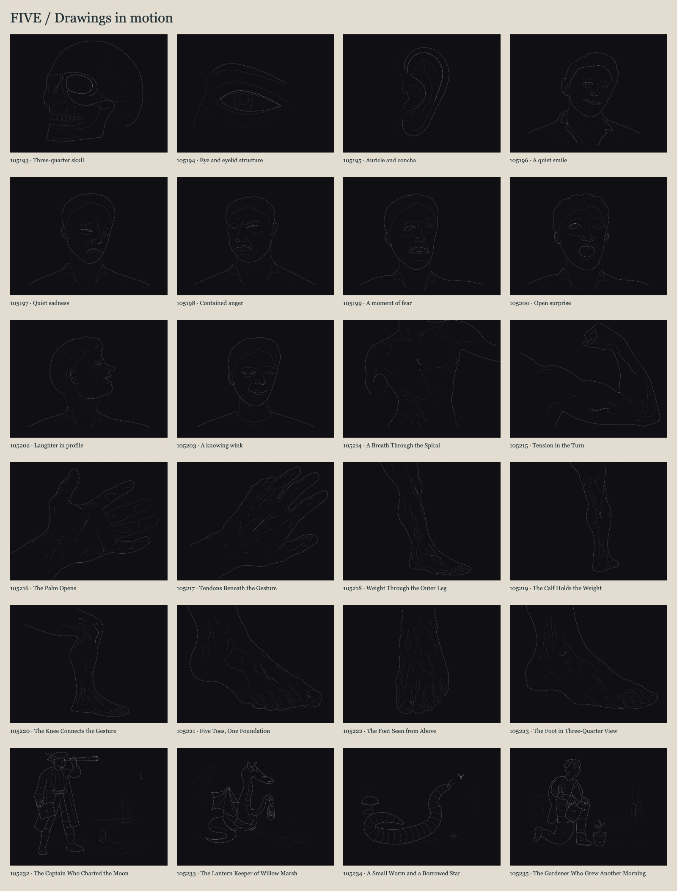

# Five — Drawings in motion

**24 static SVGs and 24 animated SVGs. Every animation loops in exactly five seconds.**

The collection uses [Hairline-inspired](https://github.com/lucasmarkes/hairline) thin contours, a charcoal ground, quiet structural lines and one focal accent. The animated versions change the drawing itself: coordinated facial features, articulated fingers, joint motion, muscle contours and character gestures. Each entry below describes its actual action.

[Download all 48 SVGs](exports/storytelling-svgs.zip) · [Reusable skill bundle](exports/seven-second-storytelling.skill.zip)

## Three.js anatomy edition

[Open FORM](three/index.html) to explore five real 3D studies: full body, arm, hand, leg and foot. Each has a five-second joint-driven movement, a guided camera that yields to manual orbit, selectable surface regions and anchored explanatory labels. [3D source and prompts](three/README.md).

[Open MUSE](expressions/index.html) for a separate facial-expression view: one original adult brunette, eight five-second acting studies, articulated features and portrait camera controls. The portrait revision uses the supplied front/profile references for facial proportions, swept hair, eye detail and studio materials. FORM's forefoot and toes share a continuous surface through the heel-rise movement. [Expression prompts and source](expressions/README.md) · [Portable FORM + MUSE bundle](exports/form-and-muse-threejs.zip). The accepted SVGs remain available below.

## Open and play

~~~sh
npm ci
npm start
~~~

Open **http://127.0.0.1:4173**. Selecting a drawing starts its animation, except when reduced motion is enabled. Play/pause, restart and scrubbing cover 0–5 seconds; Space toggles playback and arrows step outside interactive controls. Playback pauses when the tab is hidden.

The static and animated SVGs are self-contained and open directly in a browser. Animated files autoplay and loop; use the static file for reduced-motion embeddings. Delivery consists of SVG files. Older MP4s are preserved only in the archived editions.

## Drawing and movement

Native paths and vector primitives carry the artwork. There are no embedded paintings, raster filters, gradients or textures. The faces and stories use authored curves; anatomy starts from curated internal construction contours with authored repairs and motion poses. Metadata records the actual method.

Each five-second loop has readable preparation, action and recovery. Eyelids, brows, cheeks and mouths act together; fingers bend around their bases and joints; muscle contours respond to flexion or stretching; character props remain attached to their hands. Motion is built from matching-topology path poses and semantic transforms, with supporting contacts preserved. These are illustrative 2D anatomical gestures, not medically validated simulations.

Hairline informs contour hierarchy, focal restraint, occlusion and clear resting poses. Organic subjects retain their observed viewpoints. [Research notes](skills/seven-second-storytelling/references/sources.md) distinguish these choices from Hairline's isometric engine.

## Prompts, source and review

Every entry contains its drawing prompt, source observation, construction method, motion description and asset links. Supplied book photographs remain in Downloads; the distributed corpus contains original interpretations and their source IDs. [The manifest](corpus/manifest.json) preserves provenance.

Canonical inputs are corpus/svg/*.svg and corpus/hairline/*.json. The vector-*.py generators preserve geometry and pose authoring. The anatomy generator uses archived internal construction plates and Python with OpenCV, NumPy and SciPy; the face/story generators use Python's standard library. Existing SVGs need only a browser to play.

~~~sh
npm run compose       # insert authored five-second native SMIL tracks
npm run catalog       # rebuild README, manifest and skill index
npm run check         # structure, movement measurements and pose sheets
npm run playback      # sample actual automatic SVG playback across the loop
npm run verify        # playback, scrubbing, downloads and responsive gallery
npm run install-skill # update the local reusable skill
npm run bundle        # package 48 SVGs and the portable skill
~~~

QA uses Node.js 22+, pinned Playwright Core and local Chrome/Chromium; set CHROME_PATH when needed. Bundling uses Python 3. No video encoder is required. Checks measure source loop closure, repeatable seeking and substantial changes to visible geometry. Visual review checks expression, finger topology, joint attachment, occlusion and the strongest poses. Measurements support this review; they do not certify artistic quality.

Evidence: [SVG and motion checks](qa/motion-five/svg-checks.json), [automatic playback samples](qa/motion-five/playback.json), [gallery verification](qa/motion-five/verification.json), [per-drawing art review](qa/motion-five/art-review.json), and individual pose sheets below.

## Reusable skill

[Read the skill](skills/seven-second-storytelling/SKILL.md). Its existing identifier, $seven-second-storytelling, is retained for compatibility; its current default is **five seconds and SVG-only delivery**. The bundle includes all 48 SVGs, full prompts, provenance and review records. Installation updates ~/.codex/skills/seven-second-storytelling, or CODEX_HOME/skills when configured.

> Use $seven-second-storytelling to create a native SVG hand that clearly opens and curls its fingers over five seconds. Preserve believable joints and Hairline-inspired contours. Deliver static and animated SVGs, inspect the motion extremes, and record the prompt and links.

Prior editions remain in [archive/hairline-v3](archive/hairline-v3), [archive/raster-v2](archive/raster-v2) and [archive/vector-v1](archive/vector-v1). [The first MUSE edition](archive/muse-v1) also preserves the preceding complete FORM + MUSE bundle; [the prior lower-limb source](archive/three-v2) preserves the foot before its continuous-surface repair.

## Corpus

| Reference | Study | Static SVG | Animated SVG |
| --- | --- | --- | --- |
| 105193.jpg | [Three-quarter skull](#study-105193) | [Drawing](corpus/svg/105193.svg) | [Five seconds](corpus/animated/105193.svg) |
| 105194.jpg | [Eye and eyelid structure](#study-105194) | [Drawing](corpus/svg/105194.svg) | [Five seconds](corpus/animated/105194.svg) |
| 105195.jpg | [Auricle and concha](#study-105195) | [Drawing](corpus/svg/105195.svg) | [Five seconds](corpus/animated/105195.svg) |
| 105196.jpg | [A quiet smile](#study-105196) | [Drawing](corpus/svg/105196.svg) | [Five seconds](corpus/animated/105196.svg) |
| 105197.jpg | [Quiet sadness](#study-105197) | [Drawing](corpus/svg/105197.svg) | [Five seconds](corpus/animated/105197.svg) |
| 105198.jpg | [Contained anger](#study-105198) | [Drawing](corpus/svg/105198.svg) | [Five seconds](corpus/animated/105198.svg) |
| 105199.jpg | [A moment of fear](#study-105199) | [Drawing](corpus/svg/105199.svg) | [Five seconds](corpus/animated/105199.svg) |
| 105200.jpg | [Open surprise](#study-105200) | [Drawing](corpus/svg/105200.svg) | [Five seconds](corpus/animated/105200.svg) |
| 105202.jpg | [Laughter in profile](#study-105202) | [Drawing](corpus/svg/105202.svg) | [Five seconds](corpus/animated/105202.svg) |
| 105203.jpg | [A knowing wink](#study-105203) | [Drawing](corpus/svg/105203.svg) | [Five seconds](corpus/animated/105203.svg) |
| 105214.jpg | [A Breath Through the Spiral](#study-105214) | [Drawing](corpus/svg/105214.svg) | [Five seconds](corpus/animated/105214.svg) |
| 105215.jpg | [Tension in the Turn](#study-105215) | [Drawing](corpus/svg/105215.svg) | [Five seconds](corpus/animated/105215.svg) |
| 105216.jpg | [The Palm Opens](#study-105216) | [Drawing](corpus/svg/105216.svg) | [Five seconds](corpus/animated/105216.svg) |
| 105217.jpg | [Tendons Beneath the Gesture](#study-105217) | [Drawing](corpus/svg/105217.svg) | [Five seconds](corpus/animated/105217.svg) |
| 105218.jpg | [Weight Through the Outer Leg](#study-105218) | [Drawing](corpus/svg/105218.svg) | [Five seconds](corpus/animated/105218.svg) |
| 105219.jpg | [The Calf Holds the Weight](#study-105219) | [Drawing](corpus/svg/105219.svg) | [Five seconds](corpus/animated/105219.svg) |
| 105220.jpg | [The Knee Connects the Gesture](#study-105220) | [Drawing](corpus/svg/105220.svg) | [Five seconds](corpus/animated/105220.svg) |
| 105221.jpg | [Five Toes, One Foundation](#study-105221) | [Drawing](corpus/svg/105221.svg) | [Five seconds](corpus/animated/105221.svg) |
| 105222.jpg | [The Foot Seen from Above](#study-105222) | [Drawing](corpus/svg/105222.svg) | [Five seconds](corpus/animated/105222.svg) |
| 105223.jpg | [The Foot in Three-Quarter View](#study-105223) | [Drawing](corpus/svg/105223.svg) | [Five seconds](corpus/animated/105223.svg) |
| 105232.jpg | [The Captain Who Charted the Moon](#study-105232) | [Drawing](corpus/svg/105232.svg) | [Five seconds](corpus/animated/105232.svg) |
| 105233.jpg | [The Lantern Keeper of Willow Marsh](#study-105233) | [Drawing](corpus/svg/105233.svg) | [Five seconds](corpus/animated/105233.svg) |
| 105234.jpg | [A Small Worm and a Borrowed Star](#study-105234) | [Drawing](corpus/svg/105234.svg) | [Five seconds](corpus/animated/105234.svg) |
| 105235.jpg | [The Gardener Who Grew Another Morning](#study-105235) | [Drawing](corpus/svg/105235.svg) | [Five seconds](corpus/animated/105235.svg) |

## Full drawing prompts and actions

### 105193 — Three-quarter skull

**Reference:** 105193.jpg · **Category:** skull-and-orbit

**Reference observation:** The reference isolates the bony orbit, nasal aperture and zygomatic arches. Deep occlusion is nearly black, while thin rim lights make the thickness of bone readable.

**SVG drawing prompt:**

Create a clean native SVG drawing, 1200 by 900 pixels with a 400 by 300 viewBox. A complete adult skull in three-quarter view facing left. Preserve the continuous cranial vault, unequal receding orbital cavities, nasal aperture, open zygomatic arch and attached mandible. A compact natural dental arcade has distinct incisor, canine and molar forms and a quieter lower row. Reserve the focal line for the near orbital rim. Use Hairline-inspired contour discipline adapted to organic anatomy: background #101014, silhouette #a1a1aa, internal structure #52525b, receding detail #27272a, and one meaningful focal contour #fafafa. Use a uniform 0.92-pixel non-scaling stroke with round caps and joins. Favor continuous anatomical cubic curves, meaningful occlusion and clear negative space. No embedded raster images, filled tonal shapes, gradients, filters, grain, repetitive hatching, labels, borders or text. Keep a complete silhouette and generous safe margins. The original source photo supplies anatomical context; the internal realistic corpus plate supplies proportional construction. Rebuild selected contours independently, without copying a photographed page layout. Deliver STATIC and ANIMATED native SVG only. Animate this unmistakable action in a seamless FIVE-SECOND loop: The mandible opens at its hinge, pauses, closes, then makes a smaller second opening and returns in five seconds. Use coordinated matching-topology local poses, anatomically meaningful pivots and actual moving eyelid clips. Keep iris circles rigid, preserve attachment to the neck, and match the first and final pose. A whole-head wobble or color pulse alone is insufficient.

**Construction method:** Hand-authored native cubic anatomical contours and coordinated local action poses informed by source observation and the owned realistic-v2 construction plate; matching-topology SVG morphs and semantic articulation, without edge traces, bitmap embedding or generated texture.

**Five-second action:** The mandible opens at its hinge, pauses, closes, then makes a smaller second opening and returns in five seconds.

**Author review:** The accepted native still is retained.  Motion has been rebuilt as an actual five-second local action: The mandible opens at its hinge, pauses, closes, then makes a smaller second opening and returns in five seconds.

[Static SVG](corpus/svg/105193.svg) · [Animated SVG](corpus/animated/105193.svg) · [Pose sheet](qa/motion-five/105193-contact.png) · [Playback samples](qa/motion-five/105193-playback.png)

### 105194 — Eye and eyelid structure

**Reference:** 105194.jpg · **Category:** eye-anatomy

**Reference observation:** The eyeball and both lids wrap around a sphere. The brow ridge, tear lake, lid crease and lower orbital plane must turn in depth rather than become flat graphic outlines.

**SVG drawing prompt:**

Create a clean native SVG drawing, 1200 by 900 pixels with a 400 by 300 viewBox. An enlarged human eye viewed obliquely. The upper lid wraps the globe, the lower rim has a shallow asymmetric curve, and the tear duct joins the inner corner. Clip the circular iris and pupil beneath the actual lid aperture. Suggest brow and nose bridge with a few continuous contours; no eyelash texture or radiating iris decoration. Use Hairline-inspired contour discipline adapted to organic anatomy: background #101014, silhouette #a1a1aa, internal structure #52525b, receding detail #27272a, and one meaningful focal contour #fafafa. Use a uniform 0.92-pixel non-scaling stroke with round caps and joins. Favor continuous anatomical cubic curves, meaningful occlusion and clear negative space. No embedded raster images, filled tonal shapes, gradients, filters, grain, repetitive hatching, labels, borders or text. Keep a complete silhouette and generous safe margins. The original source photo supplies anatomical context; the internal realistic corpus plate supplies proportional construction. Rebuild selected contours independently, without copying a photographed page layout. Deliver STATIC and ANIMATED native SVG only. Animate this unmistakable action in a seamless FIVE-SECOND loop: The eye glances right, fully blinks, glances left, blinks again and returns; the pupil stays behind the moving eyelid aperture. Use coordinated matching-topology local poses, anatomically meaningful pivots and actual moving eyelid clips. Keep iris circles rigid, preserve attachment to the neck, and match the first and final pose. A whole-head wobble or color pulse alone is insufficient.

**Construction method:** Hand-authored native cubic anatomical contours and coordinated local action poses informed by source observation and the owned realistic-v2 construction plate; matching-topology SVG morphs and semantic articulation, without edge traces, bitmap embedding or generated texture.

**Five-second action:** The eye glances right, fully blinks, glances left, blinks again and returns; the pupil stays behind the moving eyelid aperture.

**Author review:** The accepted native still is retained.  Independent review identified an overly narrow pupil; it was broadened to a near-circular foreshortened form and re-rendered. Motion has been rebuilt as an actual five-second local action: The eye glances right, fully blinks, glances left, blinks again and returns; the pupil stays behind the moving eyelid aperture.

[Static SVG](corpus/svg/105194.svg) · [Animated SVG](corpus/animated/105194.svg) · [Pose sheet](qa/motion-five/105194-contact.png) · [Playback samples](qa/motion-five/105194-playback.png)

### 105195 — Auricle and concha

**Reference:** 105195.jpg · **Category:** ear-anatomy

**Reference observation:** The ear has a continuous helix, a bifurcated antihelix, triangular fossa, deep concha, projecting tragus and soft lobule. Its back surface and overlapping folds are volumes, not a flat symbol.

**SVG drawing prompt:**

Create a clean native SVG drawing, 1200 by 900 pixels with a 400 by 300 viewBox. One upright dimensional human ear, with a continuous helix, a branching antihelix, concha, tragus, antitragus and fleshy lobe. Show the connections between folds and preserve clean negative spaces. A short temporal attachment places the ear on a head without drawing the entire head. Focus the upper helix. Use Hairline-inspired contour discipline adapted to organic anatomy: background #101014, silhouette #a1a1aa, internal structure #52525b, receding detail #27272a, and one meaningful focal contour #fafafa. Use a uniform 0.92-pixel non-scaling stroke with round caps and joins. Favor continuous anatomical cubic curves, meaningful occlusion and clear negative space. No embedded raster images, filled tonal shapes, gradients, filters, grain, repetitive hatching, labels, borders or text. Keep a complete silhouette and generous safe margins. The original source photo supplies anatomical context; the internal realistic corpus plate supplies proportional construction. Rebuild selected contours independently, without copying a photographed page layout. Deliver STATIC and ANIMATED native SVG only. Animate this unmistakable action in a seamless FIVE-SECOND loop: A pinna-flex demonstration folds the outer ear toward its fixed attachment, rebounds and returns over five seconds; it does not imply voluntary ear articulation. Use coordinated matching-topology local poses, anatomically meaningful pivots and actual moving eyelid clips. Keep iris circles rigid, preserve attachment to the neck, and match the first and final pose. A whole-head wobble or color pulse alone is insufficient.

**Construction method:** Hand-authored native cubic anatomical contours and coordinated local action poses informed by source observation and the owned realistic-v2 construction plate; matching-topology SVG morphs and semantic articulation, without edge traces, bitmap embedding or generated texture.

**Five-second action:** A pinna-flex demonstration folds the outer ear toward its fixed attachment, rebounds and returns over five seconds; it does not imply voluntary ear articulation.

**Author review:** The accepted native still is retained.  Motion has been rebuilt as an actual five-second local action: A pinna-flex demonstration folds the outer ear toward its fixed attachment, rebounds and returns over five seconds; it does not imply voluntary ear articulation.

[Static SVG](corpus/svg/105195.svg) · [Animated SVG](corpus/animated/105195.svg) · [Pose sheet](qa/motion-five/105195-contact.png) · [Playback samples](qa/motion-five/105195-playback.png)

### 105196 — A quiet smile

**Reference:** 105196.jpg · **Category:** happiness

**Reference observation:** Relaxed brow, cheek lifting and the outward pull of the closed smiling mouth.

**SVG drawing prompt:**

Create a clean native SVG drawing, 1200 by 900 pixels with a 400 by 300 viewBox. A three-quarter adult male portrait with a relaxed smile and a slight head tilt. Lift the cheeks, soften the lower eyelids and curve the lips upward asymmetrically. Preserve adult cranial proportions, a dimensional ear, a believable nose and an open shirt collar. Clip both irises under reduced eyelid apertures; focus only the near upper eyelid. Use Hairline-inspired contour discipline adapted to organic anatomy: background #101014, silhouette #a1a1aa, internal structure #52525b, receding detail #27272a, and one meaningful focal contour #fafafa. Use a uniform 0.92-pixel non-scaling stroke with round caps and joins. Favor continuous anatomical cubic curves, meaningful occlusion and clear negative space. No embedded raster images, filled tonal shapes, gradients, filters, grain, repetitive hatching, labels, borders or text. Keep a complete silhouette and generous safe margins. The original source photo supplies anatomical context; the internal realistic corpus plate supplies proportional construction. Rebuild selected contours independently, without copying a photographed page layout. Deliver STATIC and ANIMATED native SVG only. Animate this unmistakable action in a seamless FIVE-SECOND loop: The quiet smile releases, then broadens with lifted cheeks and an opening mouth; both eyes blink and the face returns to its original smile in five seconds. Use coordinated matching-topology local poses, anatomically meaningful pivots and actual moving eyelid clips. Keep iris circles rigid, preserve attachment to the neck, and match the first and final pose. A whole-head wobble or color pulse alone is insufficient.

**Construction method:** Hand-authored native cubic anatomical contours and coordinated local action poses informed by source observation and the owned realistic-v2 construction plate; matching-topology SVG morphs and semantic articulation, without edge traces, bitmap embedding or generated texture.

**Five-second action:** The quiet smile releases, then broadens with lifted cheeks and an opening mouth; both eyes blink and the face returns to its original smile in five seconds.

**Author review:** The accepted native still is retained.  Motion has been rebuilt as an actual five-second local action: The quiet smile releases, then broadens with lifted cheeks and an opening mouth; both eyes blink and the face returns to its original smile in five seconds.

[Static SVG](corpus/svg/105196.svg) · [Animated SVG](corpus/animated/105196.svg) · [Pose sheet](qa/motion-five/105196-contact.png) · [Playback samples](qa/motion-five/105196-playback.png)

### 105197 — Quiet sadness

**Reference:** 105197.jpg · **Category:** sadness

**Reference observation:** The inner brows draw upward and together while the lip corners and gaze fall.

**SVG drawing prompt:**

Create a clean native SVG drawing, 1200 by 900 pixels with a 400 by 300 viewBox. An older adult male with an elongated face, receding swept hair and a lowered gaze. Raise and draw together the inner brows; keep the eyelids heavy and the mouth corners quietly lowered. Use nasolabial and chin contours to explain the expression instead of a generic frown. Preserve an attached long neck and open collar. Use Hairline-inspired contour discipline adapted to organic anatomy: background #101014, silhouette #a1a1aa, internal structure #52525b, receding detail #27272a, and one meaningful focal contour #fafafa. Use a uniform 0.92-pixel non-scaling stroke with round caps and joins. Favor continuous anatomical cubic curves, meaningful occlusion and clear negative space. No embedded raster images, filled tonal shapes, gradients, filters, grain, repetitive hatching, labels, borders or text. Keep a complete silhouette and generous safe margins. The original source photo supplies anatomical context; the internal realistic corpus plate supplies proportional construction. Rebuild selected contours independently, without copying a photographed page layout. Deliver STATIC and ANIMATED native SVG only. Animate this unmistakable action in a seamless FIVE-SECOND loop: The sad face relaxes toward neutral, then the inner brows lift, the lids droop and the mouth corners lower together before returning in five seconds. Use coordinated matching-topology local poses, anatomically meaningful pivots and actual moving eyelid clips. Keep iris circles rigid, preserve attachment to the neck, and match the first and final pose. A whole-head wobble or color pulse alone is insufficient.

**Construction method:** Hand-authored native cubic anatomical contours and coordinated local action poses informed by source observation and the owned realistic-v2 construction plate; matching-topology SVG morphs and semantic articulation, without edge traces, bitmap embedding or generated texture.

**Five-second action:** The sad face relaxes toward neutral, then the inner brows lift, the lids droop and the mouth corners lower together before returning in five seconds.

**Author review:** The accepted native still is retained.  Motion has been rebuilt as an actual five-second local action: The sad face relaxes toward neutral, then the inner brows lift, the lids droop and the mouth corners lower together before returning in five seconds.

[Static SVG](corpus/svg/105197.svg) · [Animated SVG](corpus/animated/105197.svg) · [Pose sheet](qa/motion-five/105197-contact.png) · [Playback samples](qa/motion-five/105197-playback.png)

### 105198 — Contained anger

**Reference:** 105198.jpg · **Category:** anger

**Reference observation:** Compressed eyebrows, narrowed lids, flared nostrils and a tense, narrow mouth.

**SVG drawing prompt:**

Create a clean native SVG drawing, 1200 by 900 pixels with a 400 by 300 viewBox. A broad-jawed adult male turned slightly left. Compress the inner brows, narrow the eyes, tighten the nostril wings and press the lips. Show a square mandibular angle, short swept hair and neck tension with a few restrained curves. Focus one near upper eyelid; avoid decorative forehead hatch marks. Use Hairline-inspired contour discipline adapted to organic anatomy: background #101014, silhouette #a1a1aa, internal structure #52525b, receding detail #27272a, and one meaningful focal contour #fafafa. Use a uniform 0.92-pixel non-scaling stroke with round caps and joins. Favor continuous anatomical cubic curves, meaningful occlusion and clear negative space. No embedded raster images, filled tonal shapes, gradients, filters, grain, repetitive hatching, labels, borders or text. Keep a complete silhouette and generous safe margins. The original source photo supplies anatomical context; the internal realistic corpus plate supplies proportional construction. Rebuild selected contours independently, without copying a photographed page layout. Deliver STATIC and ANIMATED native SVG only. Animate this unmistakable action in a seamless FIVE-SECOND loop: The brows and lips release, then the brows draw inward, eyes narrow, nostrils tense and lips press into anger; all return within five seconds. Use coordinated matching-topology local poses, anatomically meaningful pivots and actual moving eyelid clips. Keep iris circles rigid, preserve attachment to the neck, and match the first and final pose. A whole-head wobble or color pulse alone is insufficient.

**Construction method:** Hand-authored native cubic anatomical contours and coordinated local action poses informed by source observation and the owned realistic-v2 construction plate; matching-topology SVG morphs and semantic articulation, without edge traces, bitmap embedding or generated texture.

**Five-second action:** The brows and lips release, then the brows draw inward, eyes narrow, nostrils tense and lips press into anger; all return within five seconds.

**Author review:** The accepted native still is retained.  Motion has been rebuilt as an actual five-second local action: The brows and lips release, then the brows draw inward, eyes narrow, nostrils tense and lips press into anger; all return within five seconds.

[Static SVG](corpus/svg/105198.svg) · [Animated SVG](corpus/animated/105198.svg) · [Pose sheet](qa/motion-five/105198-contact.png) · [Playback samples](qa/motion-five/105198-playback.png)

### 105199 — A moment of fear

**Reference:** 105199.jpg · **Category:** fear

**Reference observation:** Wide visible irises, lifted brows and retracted lips revealing a tense strip of teeth.

**SVG drawing prompt:**

Create a clean native SVG drawing, 1200 by 900 pixels with a 400 by 300 viewBox. An adult male looking upward to the right, with raised knitted inner brows, tense wide eyes, a retracted slightly parted mouth and taut neck tendons. The lower lids remain supportive and the upper teeth are a short quiet strip. Use a slim asymmetrical jaw and swept hair. Keep the fear readable through coordinated facial muscles, not bulging eyeballs. Use Hairline-inspired contour discipline adapted to organic anatomy: background #101014, silhouette #a1a1aa, internal structure #52525b, receding detail #27272a, and one meaningful focal contour #fafafa. Use a uniform 0.92-pixel non-scaling stroke with round caps and joins. Favor continuous anatomical cubic curves, meaningful occlusion and clear negative space. No embedded raster images, filled tonal shapes, gradients, filters, grain, repetitive hatching, labels, borders or text. Keep a complete silhouette and generous safe margins. The original source photo supplies anatomical context; the internal realistic corpus plate supplies proportional construction. Rebuild selected contours independently, without copying a photographed page layout. Deliver STATIC and ANIMATED native SVG only. Animate this unmistakable action in a seamless FIVE-SECOND loop: A calmer face snaps into fear: eyes widen, inner brows lift, the mouth retracts and the lower jaw drops; the coordinated facial action returns in five seconds. Use coordinated matching-topology local poses, anatomically meaningful pivots and actual moving eyelid clips. Keep iris circles rigid, preserve attachment to the neck, and match the first and final pose. A whole-head wobble or color pulse alone is insufficient.

**Construction method:** Hand-authored native cubic anatomical contours and coordinated local action poses informed by source observation and the owned realistic-v2 construction plate; matching-topology SVG morphs and semantic articulation, without edge traces, bitmap embedding or generated texture.

**Five-second action:** A calmer face snaps into fear: eyes widen, inner brows lift, the mouth retracts and the lower jaw drops; the coordinated facial action returns in five seconds.

**Author review:** The accepted native still is retained.  Independent review identified an upper eyelid too narrow for the expression; both upper lids were lifted while the lower rims stayed fixed, then re-rendered. Motion has been rebuilt as an actual five-second local action: A calmer face snaps into fear: eyes widen, inner brows lift, the mouth retracts and the lower jaw drops; the coordinated facial action returns in five seconds.

[Static SVG](corpus/svg/105199.svg) · [Animated SVG](corpus/animated/105199.svg) · [Pose sheet](qa/motion-five/105199-contact.png) · [Playback samples](qa/motion-five/105199-playback.png)

### 105200 — Open surprise

**Reference:** 105200.jpg · **Category:** surprise

**Reference observation:** Raised orbital arches, round open eyes and a lowered jaw create surprise.

**SVG drawing prompt:**

Create a clean native SVG drawing, 1200 by 900 pixels with a 400 by 300 viewBox. An adult male with a rounder cranial shape and loose swept curls. Raise both inner and outer brows, show naturally wide eyes and drop the lower jaw for a soft vertically open mouth. Keep eyelids wrapped around clipped irises and the upper dental edge in perspective. Avoid a circular emoji mouth or symmetric graphic eyes. Use Hairline-inspired contour discipline adapted to organic anatomy: background #101014, silhouette #a1a1aa, internal structure #52525b, receding detail #27272a, and one meaningful focal contour #fafafa. Use a uniform 0.92-pixel non-scaling stroke with round caps and joins. Favor continuous anatomical cubic curves, meaningful occlusion and clear negative space. No embedded raster images, filled tonal shapes, gradients, filters, grain, repetitive hatching, labels, borders or text. Keep a complete silhouette and generous safe margins. The original source photo supplies anatomical context; the internal realistic corpus plate supplies proportional construction. Rebuild selected contours independently, without copying a photographed page layout. Deliver STATIC and ANIMATED native SVG only. Animate this unmistakable action in a seamless FIVE-SECOND loop: The open mouth closes and brows settle, then a visible gasp lifts both brows, opens the eyes and drops the jaw; the face returns within five seconds. Use coordinated matching-topology local poses, anatomically meaningful pivots and actual moving eyelid clips. Keep iris circles rigid, preserve attachment to the neck, and match the first and final pose. A whole-head wobble or color pulse alone is insufficient.

**Construction method:** Hand-authored native cubic anatomical contours and coordinated local action poses informed by source observation and the owned realistic-v2 construction plate; matching-topology SVG morphs and semantic articulation, without edge traces, bitmap embedding or generated texture.

**Five-second action:** The open mouth closes and brows settle, then a visible gasp lifts both brows, opens the eyes and drops the jaw; the face returns within five seconds.

**Author review:** The accepted native still is retained.  Independent review identified normal-width eyes beneath strongly raised brows; the upper lids were lifted without moving the lower rims, then re-rendered. The mouth was also widened and made less circular. Motion has been rebuilt as an actual five-second local action: The open mouth closes and brows settle, then a visible gasp lifts both brows, opens the eyes and drops the jaw; the face returns within five seconds.

[Static SVG](corpus/svg/105200.svg) · [Animated SVG](corpus/animated/105200.svg) · [Pose sheet](qa/motion-five/105200-contact.png) · [Playback samples](qa/motion-five/105200-playback.png)

### 105202 — Laughter in profile

**Reference:** 105202.jpg · **Category:** laughter-profile

**Reference observation:** The profile laugh combines a rising cheek, compressed eyelid, deepened nasolabial fold and lowered mandible. The teeth wrap in perspective and the neck responds to the jaw.

**SVG drawing prompt:**

Create a clean native SVG drawing, 1200 by 900 pixels with a 400 by 300 viewBox. A right-facing adult male profile in laughter. Draw one eye only, compressed by a raised cheek. Connect forehead, nasal bridge, nose tip, upper lip, receding open mouth, lower lip and chin as a continuous profile silhouette. A small perspective dental edge sits beneath the upper lip. Show the near ear and the neck leading naturally into an open collar. Use Hairline-inspired contour discipline adapted to organic anatomy: background #101014, silhouette #a1a1aa, internal structure #52525b, receding detail #27272a, and one meaningful focal contour #fafafa. Use a uniform 0.92-pixel non-scaling stroke with round caps and joins. Favor continuous anatomical cubic curves, meaningful occlusion and clear negative space. No embedded raster images, filled tonal shapes, gradients, filters, grain, repetitive hatching, labels, borders or text. Keep a complete silhouette and generous safe margins. The original source photo supplies anatomical context; the internal realistic corpus plate supplies proportional construction. Rebuild selected contours independently, without copying a photographed page layout. Deliver STATIC and ANIMATED native SVG only. Animate this unmistakable action in a seamless FIVE-SECOND loop: The profile laugh releases to a closed mouth and open eye, then the jaw opens, cheek rises and eye squeezes shut again in a five-second acting loop. Use coordinated matching-topology local poses, anatomically meaningful pivots and actual moving eyelid clips. Keep iris circles rigid, preserve attachment to the neck, and match the first and final pose. A whole-head wobble or color pulse alone is insufficient.

**Construction method:** Hand-authored native cubic anatomical contours and coordinated local action poses informed by source observation and the owned realistic-v2 construction plate; matching-topology SVG morphs and semantic articulation, without edge traces, bitmap embedding or generated texture.

**Five-second action:** The profile laugh releases to a closed mouth and open eye, then the jaw opens, cheek rises and eye squeezes shut again in a five-second acting loop.

**Author review:** The accepted native still is retained.  Motion has been rebuilt as an actual five-second local action: The profile laugh releases to a closed mouth and open eye, then the jaw opens, cheek rises and eye squeezes shut again in a five-second acting loop.

[Static SVG](corpus/svg/105202.svg) · [Animated SVG](corpus/animated/105202.svg) · [Pose sheet](qa/motion-five/105202-contact.png) · [Playback samples](qa/motion-five/105202-playback.png)

### 105203 — A knowing wink

**Reference:** 105203.jpg · **Category:** asymmetric-expression

**Reference observation:** A unilateral eyelid squeeze, one raised eyebrow and one tight mouth corner make an asymmetric expression.

**SVG drawing prompt:**

Create a clean native SVG drawing, 1200 by 900 pixels with a 400 by 300 viewBox. An adult male portrait with one eye closed, the same-side cheek lifted, the other eye gently open, and an asymmetric closed-mouth smile. Coordinate the closed lid, crow-feet and compressed cheek rather than deleting the eye. Draw distinct swept hair, a tapered jaw and a crew-neck shirt. Reserve the focal accent for the closed eyelid. Use Hairline-inspired contour discipline adapted to organic anatomy: background #101014, silhouette #a1a1aa, internal structure #52525b, receding detail #27272a, and one meaningful focal contour #fafafa. Use a uniform 0.92-pixel non-scaling stroke with round caps and joins. Favor continuous anatomical cubic curves, meaningful occlusion and clear negative space. No embedded raster images, filled tonal shapes, gradients, filters, grain, repetitive hatching, labels, borders or text. Keep a complete silhouette and generous safe margins. The original source photo supplies anatomical context; the internal realistic corpus plate supplies proportional construction. Rebuild selected contours independently, without copying a photographed page layout. Deliver STATIC and ANIMATED native SVG only. Animate this unmistakable action in a seamless FIVE-SECOND loop: The closed eye opens, then makes two clear winks as the same-side cheek lifts and the smile returns; the clipped iris disappears completely on each closure. Use coordinated matching-topology local poses, anatomically meaningful pivots and actual moving eyelid clips. Keep iris circles rigid, preserve attachment to the neck, and match the first and final pose. A whole-head wobble or color pulse alone is insufficient.

**Construction method:** Hand-authored native cubic anatomical contours and coordinated local action poses informed by source observation and the owned realistic-v2 construction plate; matching-topology SVG morphs and semantic articulation, without edge traces, bitmap embedding or generated texture.

**Five-second action:** The closed eye opens, then makes two clear winks as the same-side cheek lifts and the smile returns; the clipped iris disappears completely on each closure.

**Author review:** The accepted native still is retained.  Motion has been rebuilt as an actual five-second local action: The closed eye opens, then makes two clear winks as the same-side cheek lifts and the smile returns; the clipped iris disappears completely on each closure.

[Static SVG](corpus/svg/105203.svg) · [Animated SVG](corpus/animated/105203.svg) · [Pose sheet](qa/motion-five/105203-contact.png) · [Playback samples](qa/motion-five/105203-playback.png)

### 105214 — A Breath Through the Spiral

**Reference:** 105214.jpg · **Category:** torso

**Reference observation:** The reference studies ribcage and pelvis counter-rotation, a raised shoulder and compression/stretch along the abdominal wall.

**SVG drawing prompt:**

Draw a breath through the spiral as native SVG anatomical line art derived from the owned 105214 graphite plate. Preserve the original gesture, perspective, joints and digit topology. Use charcoal #101014 ground, a thin #a1a1aa silhouette, sparse #52525b structural contours and one #fafafa focal contour. Smooth the curves; remove texture scratches, shadow bands and redundant anatomy marks. No raster embedding, gradients, filters, shading fills or labels. Compose at 1200 by 900 with clear contact and negative space. Animate over exactly five seconds: Waist-anchored torso stretch: ribcage bends visibly, opposing chest contours expand, then the figure returns to rest. Preserve joint attachment, anatomical lengths and the named support contacts. The first and last native path poses must match.

**Construction method:** Low-pass structural edge extraction from owned plate; graph-connected curves, directional gap joining, cubic simplification and per-subject removal/repair. Anatomical silhouette gaps are explicitly repaired at the torso, dorsal hand and foot contact contours.

**Five-second action:** Waist-anchored torso stretch: ribcage bends visibly, opposing chest contours expand, then the figure returns to rest.

**Author review:** Inspected the native SVG in Chrome at full size and in the contact sheet. Reconnected the armpit and raised-shoulder contours after the raster source faded there; ribcage/waist counter-rotation remains readable. Cropped neck and arm ends are intentional study framing. Final five-second motion review: The ribcage bends from the waist while the chest contours respond. Reduced the draft bend from 7.5 to 5 degrees to improve framing; the original cropped neck and arm study edges remain intentional.

[Static SVG](corpus/svg/105214.svg) · [Animated SVG](corpus/animated/105214.svg) · [Pose sheet](qa/motion-five/105214-contact.png) · [Playback samples](qa/motion-five/105214-playback.png)

### 105215 — Tension in the Turn

**Reference:** 105215.jpg · **Category:** arm

**Reference observation:** The reference shows a flexed elbow, biceps/triceps interaction and the twisting forearm masses. The final study retains living skin rather than colored muscle diagrams.

**SVG drawing prompt:**

Draw tension in the turn as native SVG anatomical line art derived from the owned 105215 graphite plate. Preserve the original gesture, perspective, joints and digit topology. Use charcoal #101014 ground, a thin #a1a1aa silhouette, sparse #52525b structural contours and one #fafafa focal contour. Smooth the curves; remove texture scratches, shadow bands and redundant anatomy marks. No raster embedding, gradients, filters, shading fills or labels. Compose at 1200 by 900 with clear contact and negative space. Animate over exactly five seconds: Visible elbow flexion carries the closed fist toward the shoulder; the upper-arm muscle contour swells under load and relaxes. Preserve joint attachment, anatomical lengths and the named support contacts. The first and last native path poses must match.

**Construction method:** Low-pass structural edge extraction from owned plate; graph-connected curves, directional gap joining, cubic simplification and per-subject removal/repair. Anatomical silhouette gaps are explicitly repaired at the torso, dorsal hand and foot contact contours.

**Five-second action:** Visible elbow flexion carries the closed fist toward the shoulder; the upper-arm muscle contour swells under load and relaxes.

**Author review:** Inspected the native SVG in Chrome. Preserved the elbow triangle, tapered forearm and closed fist while reducing the bodybuilder-looking shadow divisions to a small number of continuous anatomical lines. Final five-second motion review: The fist and forearm flex from the elbow with a biceps-contour response. Reduced draft flex from 18 to 12 degrees and muscle swell from 0.19 to 0.12 to avoid a crowded inner elbow.

[Static SVG](corpus/svg/105215.svg) · [Animated SVG](corpus/animated/105215.svg) · [Pose sheet](qa/motion-five/105215-contact.png) · [Playback samples](qa/motion-five/105215-playback.png)

### 105216 — The Palm Opens

**Reference:** 105216.jpg · **Category:** hand

**Reference observation:** The reference explains finger segment lengths, thumb opposition, the thenar pad and the cupped palm in perspective.

**SVG drawing prompt:**

Draw the palm opens as native SVG anatomical line art derived from the owned 105216 graphite plate. Preserve the original gesture, perspective, joints and digit topology. Use charcoal #101014 ground, a thin #a1a1aa silhouette, sparse #52525b structural contours and one #fafafa focal contour. Smooth the curves; remove texture scratches, shadow bands and redundant anatomy marks. No raster embedding, gradients, filters, shading fills or labels. Compose at 1200 by 900 with clear contact and negative space. Animate over exactly five seconds: The five digits close their fan at their own palm joints, with a visibly opposing thumb; wrist and palm remain anchored. Preserve joint attachment, anatomical lengths and the named support contacts. The first and last native path poses must match.

**Construction method:** Low-pass structural edge extraction from owned plate; graph-connected curves, directional gap joining, cubic simplification and per-subject removal/repair. Anatomical silhouette gaps are explicitly repaired at the torso, dorsal hand and foot contact contours.

**Five-second action:** The five digits close their fan at their own palm joints, with a visibly opposing thumb; wrist and palm remain anchored.

**Author review:** Inspected the native SVG in Chrome. Five digits, thumb opposition, finger-web topology and the palmar cup read clearly. The outside contour is stronger than the sparse palm and joint creases; texture scratches were removed. Final five-second motion review: The five digits narrow their fan and the thumb opposes while the wrist and palm stay anchored. Finger webs stay readable; this is an open-hand articulation rather than a complete fist closure.

[Static SVG](corpus/svg/105216.svg) · [Animated SVG](corpus/animated/105216.svg) · [Pose sheet](qa/motion-five/105216-contact.png) · [Playback samples](qa/motion-five/105216-playback.png)

### 105217 — Tendons Beneath the Gesture

**Reference:** 105217.jpg · **Category:** hand

**Reference observation:** The source emphasizes dorsal tendons flowing into knuckles and finger centerlines receding in perspective.

**SVG drawing prompt:**

Draw tendons beneath the gesture as native SVG anatomical line art derived from the owned 105217 graphite plate. Preserve the original gesture, perspective, joints and digit topology. Use charcoal #101014 ground, a thin #a1a1aa silhouette, sparse #52525b structural contours and one #fafafa focal contour. Smooth the curves; remove texture scratches, shadow bands and redundant anatomy marks. No raster embedding, gradients, filters, shading fills or labels. Compose at 1200 by 900 with clear contact and negative space. Animate over exactly five seconds: The fingers spread into a clear fan while the thumb opens and dorsal tendon contours tighten; wrist remains anchored. Preserve joint attachment, anatomical lengths and the named support contacts. The first and last native path poses must match.

**Construction method:** Low-pass structural edge extraction from owned plate; graph-connected curves, directional gap joining, cubic simplification and per-subject removal/repair. Anatomical silhouette gaps are explicitly repaired at the torso, dorsal hand and foot contact contours.

**Five-second action:** The fingers spread into a clear fan while the thumb opens and dorsal tendon contours tighten; wrist remains anchored.

**Author review:** Inspected the native SVG in Chrome and repaired the thumb web, lower palm and wrist silhouette. Five digits are connected through a clear dorsal-hand outline. Tendon and knuckle lines remain subordinate; the small finger retains its source foreshortening. Final five-second motion review: The finger fan and thumb visibly open with tendon response. Removed a doubled web repair and shortened its competing silhouette tail; the reopened full-size peak has a single clean web contour.

[Static SVG](corpus/svg/105217.svg) · [Animated SVG](corpus/animated/105217.svg) · [Pose sheet](qa/motion-five/105217-contact.png) · [Playback samples](qa/motion-five/105217-playback.png)

### 105218 — Weight Through the Outer Leg

**Reference:** 105218.jpg · **Category:** leg

**Reference observation:** The source examines lateral thigh and calf planes, knee transition and the long taper toward the ankle.

**SVG drawing prompt:**

Draw weight through the outer leg as native SVG anatomical line art derived from the owned 105218 graphite plate. Preserve the original gesture, perspective, joints and digit topology. Use charcoal #101014 ground, a thin #a1a1aa silhouette, sparse #52525b structural contours and one #fafafa focal contour. Smooth the curves; remove texture scratches, shadow bands and redundant anatomy marks. No raster embedding, gradients, filters, shading fills or labels. Compose at 1200 by 900 with clear contact and negative space. Animate over exactly five seconds: The planted foot supports a visible knee load: shin inclines at the ankle, thigh counter-rotates at the knee and calf contour expands. Preserve joint attachment, anatomical lengths and the named support contacts. The first and last native path poses must match.

**Construction method:** Low-pass structural edge extraction from owned plate; graph-connected curves, directional gap joining, cubic simplification and per-subject removal/repair. Anatomical silhouette gaps are explicitly repaired at the torso, dorsal hand and foot contact contours.

**Five-second action:** The planted foot supports a visible knee load: shin inclines at the ankle, thigh counter-rotates at the knee and calf contour expands.

**Author review:** Inspected the native SVG in Chrome. Repaired the heel-to-arch contact contour and removed the cast-shadow line; the knee/calf/ankle relationship is continuous. Removed short nonstructural leg marks to preserve negative space. Final five-second motion review: The knee and shin shift above a fixed foot, with a calf-contour response and thigh counter-rotation. The ankle-to-foot contact remains continuous in the inspected poses.

[Static SVG](corpus/svg/105218.svg) · [Animated SVG](corpus/animated/105218.svg) · [Pose sheet](qa/motion-five/105218-contact.png) · [Playback samples](qa/motion-five/105218-playback.png)

### 105219 — The Calf Holds the Weight

**Reference:** 105219.jpg · **Category:** leg

**Reference observation:** The photo studies the posterior thigh, knee hollow, two calf heads and Achilles tendon, including the interlocking forms around the rear knee.

**SVG drawing prompt:**

Draw the calf holds the weight as native SVG anatomical line art derived from the owned 105219 graphite plate. Preserve the original gesture, perspective, joints and digit topology. Use charcoal #101014 ground, a thin #a1a1aa silhouette, sparse #52525b structural contours and one #fafafa focal contour. Smooth the curves; remove texture scratches, shadow bands and redundant anatomy marks. No raster embedding, gradients, filters, shading fills or labels. Compose at 1200 by 900 with clear contact and negative space. Animate over exactly five seconds: Heel rises around a planted forefoot; ankle and lower leg follow the lift while the calf visibly contracts, then the heel settles. Preserve joint attachment, anatomical lengths and the named support contacts. The first and last native path poses must match.

**Construction method:** Low-pass structural edge extraction from owned plate; graph-connected curves, directional gap joining, cubic simplification and per-subject removal/repair. Anatomical silhouette gaps are explicitly repaired at the torso, dorsal hand and foot contact contours.

**Five-second action:** Heel rises around a planted forefoot; ankle and lower leg follow the lift while the calf visibly contracts, then the heel settles.

**Author review:** Inspected the native SVG in Chrome. Reconnected the rear heel and trimmed the false ground-shadow tail. Asymmetric calf heads, knee hollow and Achilles direction remain readable with fewer short vein fragments. Final five-second motion review: A heel lift and calf contraction read together. The forefoot provides the pivot; the Achilles direction and knee hollow remain legible through recovery.

[Static SVG](corpus/svg/105219.svg) · [Animated SVG](corpus/animated/105219.svg) · [Pose sheet](qa/motion-five/105219-contact.png) · [Playback samples](qa/motion-five/105219-playback.png)

### 105220 — The Knee Connects the Gesture

**Reference:** 105220.jpg · **Category:** leg

**Reference observation:** Corrected source mapping: 105220.jpg depicts the outer leg and a bent knee, not an arm. This study uses the seated bend to show thigh/calf connection across the knee.

**SVG drawing prompt:**

Draw the knee connects the gesture as native SVG anatomical line art derived from the owned 105220 graphite plate. Preserve the original gesture, perspective, joints and digit topology. Use charcoal #101014 ground, a thin #a1a1aa silhouette, sparse #52525b structural contours and one #fafafa focal contour. Smooth the curves; remove texture scratches, shadow bands and redundant anatomy marks. No raster embedding, gradients, filters, shading fills or labels. Compose at 1200 by 900 with clear contact and negative space. Animate over exactly five seconds: The bent knee advances over a planted foot through ankle rotation and thigh counter-rotation; calf responds to the load. Preserve joint attachment, anatomical lengths and the named support contacts. The first and last native path poses must match.

**Construction method:** Low-pass structural edge extraction from owned plate; graph-connected curves, directional gap joining, cubic simplification and per-subject removal/repair. Anatomical silhouette gaps are explicitly repaired at the torso, dorsal hand and foot contact contours.

**Five-second action:** The bent knee advances over a planted foot through ankle rotation and thigh counter-rotation; calf responds to the load.

**Author review:** Inspected the native SVG in Chrome. Correct leg category follows the actual source. The bent-knee connection and heel/sole are continuous; removed the stray heel tip and reduced short interior marks. The upper-thigh crop is intentional. Final five-second motion review: The bent knee loads and recovers while the foot stays planted. The thigh, kneecap and shin relationship remains continuous; the upper-thigh crop is intentional.

[Static SVG](corpus/svg/105220.svg) · [Animated SVG](corpus/animated/105220.svg) · [Pose sheet](qa/motion-five/105220-contact.png) · [Playback samples](qa/motion-five/105220-playback.png)

### 105221 — Five Toes, One Foundation

**Reference:** 105221.jpg · **Category:** foot

**Reference observation:** The source distinguishes broad padded toes from fingers and shows their stepped joint arc and the sloping forefoot.

**SVG drawing prompt:**

Draw five toes, one foundation as native SVG anatomical line art derived from the owned 105221 graphite plate. Preserve the original gesture, perspective, joints and digit topology. Use charcoal #101014 ground, a thin #a1a1aa silhouette, sparse #52525b structural contours and one #fafafa focal contour. Smooth the curves; remove texture scratches, shadow bands and redundant anatomy marks. No raster embedding, gradients, filters, shading fills or labels. Compose at 1200 by 900 with clear contact and negative space. Animate over exactly five seconds: Five toe rays articulate from their individual forefoot joints, led by a visible great-toe lift; heel and ankle remain fixed. Preserve joint attachment, anatomical lengths and the named support contacts. The first and last native path poses must match.

**Construction method:** Low-pass structural edge extraction from owned plate; graph-connected curves, directional gap joining, cubic simplification and per-subject removal/repair. Anatomical silhouette gaps are explicitly repaired at the torso, dorsal hand and foot contact contours.

**Five-second action:** Five toe rays articulate from their individual forefoot joints, led by a visible great-toe lift; heel and ankle remain fixed.

**Author review:** Inspected the native SVG in Chrome. Repaired the heel, forefoot and stepped toe silhouette; five toe forms remain distinct. Removed shadow bands under the heel and the least useful short vein traces. Interior marks describe joints and nail planes rather than tonal shading. Final five-second motion review: The great toe leads a visible toe lift and release with the heel and ankle held. Five toe forms remain legible, with no extra digit or detached nail in the inspected poses.

[Static SVG](corpus/svg/105221.svg) · [Animated SVG](corpus/animated/105221.svg) · [Pose sheet](qa/motion-five/105221-contact.png) · [Playback samples](qa/motion-five/105221-playback.png)

### 105222 — The Foot Seen from Above

**Reference:** 105222.jpg · **Category:** foot

**Reference observation:** The reference provides dorsal/front and side comparisons. The chosen final plate is a true overhead view with the foot pointing down the page.

**SVG drawing prompt:**

Draw the foot seen from above as native SVG anatomical line art derived from the owned 105222 graphite plate. Preserve the original gesture, perspective, joints and digit topology. Use charcoal #101014 ground, a thin #a1a1aa silhouette, sparse #52525b structural contours and one #fafafa focal contour. Smooth the curves; remove texture scratches, shadow bands and redundant anatomy marks. No raster embedding, gradients, filters, shading fills or labels. Compose at 1200 by 900 with clear contact and negative space. Animate over exactly five seconds: Five toes spread visibly from their metatarsal joints into a fan; the ankle and main foot remain fixed. Preserve joint attachment, anatomical lengths and the named support contacts. The first and last native path poses must match.

**Construction method:** Low-pass structural edge extraction from owned plate; graph-connected curves, directional gap joining, cubic simplification and per-subject removal/repair. Anatomical silhouette gaps are explicitly repaired at the torso, dorsal hand and foot contact contours.

**Five-second action:** Five toes spread visibly from their metatarsal joints into a fan; the ankle and main foot remain fixed.

**Author review:** Inspected the native SVG in Chrome. A true dorsal view with all five toes, graduated widths and a continuous front edge. Replaced the fragmented left ankle with one deliberate continuous contour and removed its duplicate fragments. Long metatarsal/tendon directions retain the viewpoint. Final five-second motion review: The toe fan opens and closes while the ankle stays fixed. The toe tips and metatarsal directions remain connected and distinct.

[Static SVG](corpus/svg/105222.svg) · [Animated SVG](corpus/animated/105222.svg) · [Pose sheet](qa/motion-five/105222-contact.png) · [Playback samples](qa/motion-five/105222-playback.png)

### 105223 — The Foot in Three-Quarter View

**Reference:** 105223.jpg · **Category:** foot

**Reference observation:** The source teaches the continuous transition from ankle through heel and arch into the toes. This interpretation shows a lateral/dorsal three-quarter foot with the great toe on the far side; it is not a dedicated medial-arch view.

**SVG drawing prompt:**

Draw the foot in three-quarter view as native SVG anatomical line art derived from the owned 105223 graphite plate. Preserve the original gesture, perspective, joints and digit topology. Use charcoal #101014 ground, a thin #a1a1aa silhouette, sparse #52525b structural contours and one #fafafa focal contour. Smooth the curves; remove texture scratches, shadow bands and redundant anatomy marks. No raster embedding, gradients, filters, shading fills or labels. Compose at 1200 by 900 with clear contact and negative space. Animate over exactly five seconds: The heel rises visibly around the planted ball of the foot; the ankle and Achilles follow while the toes hold support. Preserve joint attachment, anatomical lengths and the named support contacts. The first and last native path poses must match.

**Construction method:** Low-pass structural edge extraction from owned plate; graph-connected curves, directional gap joining, cubic simplification and per-subject removal/repair. Anatomical silhouette gaps are explicitly repaired at the torso, dorsal hand and foot contact contours.

**Five-second action:** The heel rises visibly around the planted ball of the foot; the ankle and Achilles follow while the toes hold support.

**Author review:** Inspected the native SVG in Chrome. Rebuilt the lost heel/arch/anterior-ankle silhouette around the retained observed toe contours. Smoothed the little-toe sole shelf and the pointed great-toe lip into deliberate anatomical arcs. Removed cast-shadow bands and low-value short traces. This is a curated line interpretation of the owned plate, not a 3D reconstruction. Final five-second motion review: The heel lifts around the ball of the foot with the toe contact held. The heel-to-arch silhouette stays continuous; the accepted three-quarter viewpoint remains intact.

[Static SVG](corpus/svg/105223.svg) · [Animated SVG](corpus/animated/105223.svg) · [Pose sheet](qa/motion-five/105223-contact.png) · [Playback samples](qa/motion-five/105223-playback.png)

### 105232 — The Captain Who Charted the Moon

**Reference:** 105232.jpg · **Category:** pirate

**Reference observation:** A book photograph of two swashbucklers: convincing counterweighted poses, layered costume, foreshortened hands, broad hat silhouettes, curved cloth folds and dense directional crosshatching. The new scene studies these principles without tracing either figure.

**SVG drawing prompt:**

An adult weathered seafarer standing on a pier, eye aligned with a long brass telescope, a star chart held at his side. Build native cubic silhouettes with adult proportions, five-finger grips and planted boots; retain only the hat, coat construction, face profile, telescope sections and sparse harbor depth cues. Use charcoal occlusion plates, a 1.1-pixel monochrome stroke hierarchy and one bright lens rim. No texture trace, image, gradient, glow, caption or colored fill. Animate a clearly visible five-second returning action: The captain raises the telescope to scan, turns his head with the eyepiece, then lowers the view; the gripping fingers follow the tube, shoulder and neck stay attached, and the boots remain planted. Use authored matching-topology path poses, preserve hand-prop attachment and fixed ground contacts, and keep the action legible at 300 pixels wide.

**Construction method:** Hand-authored native SVG contours with articulated matching-topology action poses; no raster embedded, automatic paint trace, or whole-frame wobble.

**Five-second action:** The captain raises the telescope to scan, turns his head with the eyepiece, then lowers the view; the gripping fingers follow the tube, shoulder and neck stay attached, and the boots remain planted.

**Author review:** Viewed seven native poses at actual 300px size and full-size upward scan. The telescope, five-digit grip and face follow the same scan; the shoulder and neck taper remain attached, both boots stay fixed, and the tube retains frame clearance. The waist is fixed while coat tails respond. This is a visible scan rather than the previous feather-only motion.

[Static SVG](corpus/svg/105232.svg) · [Animated SVG](corpus/animated/105232.svg) · [Pose sheet](qa/motion-five/105232-contact.png) · [Playback samples](qa/motion-five/105232-playback.png)

### 105233 — The Lantern Keeper of Willow Marsh

**Reference:** 105233.jpg · **Category:** creature

**Reference observation:** A fantasy-illustration page combines long curling tentacles, dramatic thin-versus-heavy silhouettes, layered organic surfaces and a theatrical figure high above elaborate creatures. The new dragon uses the serpentine construction and etched surface rhythm, with an original gentle story.

**SVG drawing prompt:**

A grounded heavy marsh dragon with a continuous curved neck, folded wing bones and a claw genuinely supporting a lantern ring. Author clean silhouettes and a few structural creases; keep the paw, tail and belly on the bank. Monochrome charcoal Hairline-inspired line hierarchy, with the flame as the only bright accent. Omit scales, foliage noise and tonal shading; native SVG geometry only. Animate a clearly visible five-second returning action: The dragon inhales, raises and bends its neck, and opens the near wing before settling; the supporting arm lifts the lantern by its ring and the lamp follows with a delayed swing while tail and resting paw stay grounded. Use authored matching-topology path poses, preserve hand-prop attachment and fixed ground contacts, and keep the action legible at 300 pixels wide.

**Construction method:** Hand-authored native SVG contours with articulated matching-topology action poses; no raster embedded, automatic paint trace, or whole-frame wobble.

**Five-second action:** The dragon inhales, raises and bends its neck, and opens the near wing before settling; the supporting arm lifts the lantern by its ring and the lamp follows with a delayed swing while tail and resting paw stay grounded.

**Author review:** Viewed seven native poses at actual 300px size and the full-size maximum neck bend. The head and horns follow one neck pose, the near wing opens, and the claw/ring stay attached while the carried lantern lifts and swings. Tail and resting paw remain fixed. Wing membranes and dragon physiology remain illustrative fantasy anatomy.

[Static SVG](corpus/svg/105233.svg) · [Animated SVG](corpus/animated/105233.svg) · [Pose sheet](qa/motion-five/105233-contact.png) · [Playback samples](qa/motion-five/105233-playback.png)

### 105234 — A Small Worm and a Borrowed Star

**Reference:** 105234.jpg · **Category:** worm

**Reference observation:** A fantastical worm drawing emphasizes broad compressed body masses, folded neck anatomy, strong cross-contour shading and curling horn silhouettes around a skull-like head. This original child-friendly scene keeps the weight, segmentation and curling silhouette while replacing the horror face with curiosity.

**SVG drawing prompt:**

A continuous coiled soft-bodied worm raises its small animal-like head toward a firefly. Construct an authored swept contour with sparse curved segment seams, two fine feelers and a small near eye. Keep the coil weighted on the ground, the mushrooms quiet and the firefly the single bright stroke. Native SVG paths on charcoal, no bitmap, texture, gradient, glow or human face pasted onto the worm. Animate a clearly visible five-second returning action: The worm compresses in anticipation, extends its continuous neck toward the rising firefly, and settles back into the same weighted coil; segment seams, eye, mouth and feelers follow the same authored body poses. Use authored matching-topology path poses, preserve hand-prop attachment and fixed ground contacts, and keep the action legible at 300 pixels wide.

**Construction method:** Hand-authored native SVG contours with articulated matching-topology action poses; no raster embedded, automatic paint trace, or whole-frame wobble.

**Five-second action:** The worm compresses in anticipation, extends its continuous neck toward the rising firefly, and settles back into the same weighted coil; segment seams, eye, mouth and feelers follow the same authored body poses.

**Author review:** Viewed seven native poses at actual 300px size plus full-size compression and extension extremes. The centerline is resampled with identical topology; the coil is fixed, the neck extends visibly, cross-seams stay within the continuous silhouette, and head details follow the tip tangent. No contour pinch or detached eye/feeler was visible in those samples.

[Static SVG](corpus/svg/105234.svg) · [Animated SVG](corpus/animated/105234.svg) · [Pose sheet](qa/motion-five/105234-contact.png) · [Playback samples](qa/motion-five/105234-playback.png)

### 105235 — The Gardener Who Grew Another Morning

**Reference:** 105235.jpg · **Category:** zombie

**Reference observation:** The reference shows an expressive undead head with pronounced facial planes, irregular teeth, tousled hair, torn cloth, articulated fingers and a decorated mug. This original gently comic gardener carries over the expressive structure, sewn repairs and handled vessel, without exposed tissue or gore.

**SVG drawing prompt:**

An elderly kindly undead gardener kneels with one boot planted and one knee down, holding a ceramic jug by its handle to water a sapling. Author believable adult proportions, a clear five-digit grip, restrained facial creases and a few stitches without gore. Quiet native cubic contours on charcoal; water is the single bright accent. Use only background-colored occlusion plates, no texture trace, colored fill, gradients or embedded image. Animate a clearly visible five-second returning action: The gardener nods toward the pot and tips the jug with the attached forearm and gripping hand. A changing stream begins during the tip, stops as the jug returns, and the rooted sapling answers with a gentle lean; knee, boot and pot remain fixed. Use authored matching-topology path poses, preserve hand-prop attachment and fixed ground contacts, and keep the action legible at 300 pixels wide.

**Construction method:** Hand-authored native SVG contours with articulated matching-topology action poses; no raster embedded, automatic paint trace, or whole-frame wobble.

**Five-second action:** The gardener nods toward the pot and tips the jug with the attached forearm and gripping hand. A changing stream begins during the tip, stops as the jug returns, and the rooted sapling answers with a gentle lean; knee, boot and pot remain fixed.

**Author review:** Viewed seven native poses at actual 300px size plus full-size anticipation and pouring extremes. Forearm, gripping fingers, jug handle and spout follow a shared tip, while the shoulder, grounded knee, planted boot and pot remain fixed. The stream starts at the moving spout and ends inside the pot; it fades out on the return. The nod and rooted plant response remain secondary. Water is an authored line gesture rather than fluid simulation.

[Static SVG](corpus/svg/105235.svg) · [Animated SVG](corpus/animated/105235.svg) · [Pose sheet](qa/motion-five/105235-contact.png) · [Playback samples](qa/motion-five/105235-playback.png)
