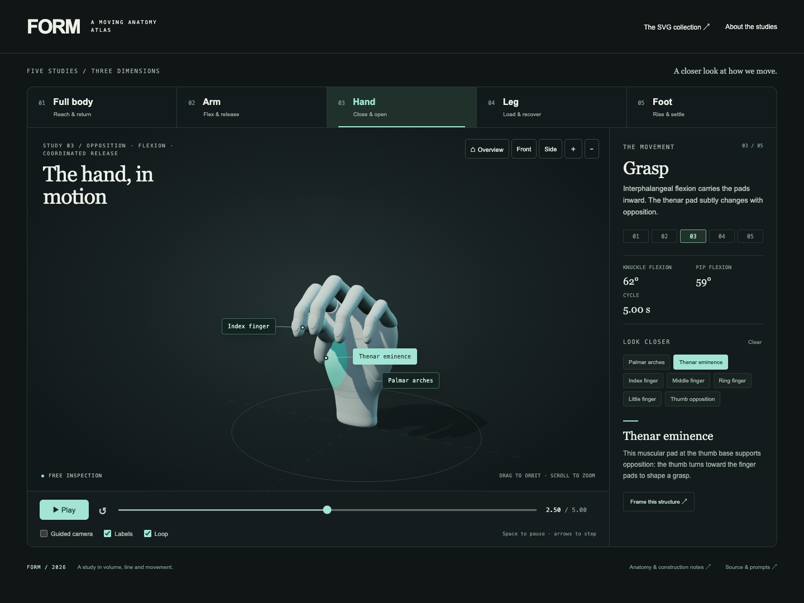

# FORM — Anatomy in motion

Five original Three.js anatomy studies: **full body, arm, hand, leg and foot**. Each has a five-second movement, editable native 3D geometry, selectable structures, explanatory labels and an interruptible guided camera.

[Open the explorer](index.html) · [Existing SVG collection](../index.html)

## Run locally

From this skill’s `assets/` directory, run `python3 -m http.server 4173 --bind 127.0.0.1` and open http://127.0.0.1:4173/three/. All browser dependencies are bundled locally. Keep the entire `assets/` folder together so the SVG collection and review links remain available.

## Inspect the movement

- Select a study, play or pause, and scrub anywhere from 0 to 5 seconds. Phase buttons jump to useful poses.
- Select a 3D form, its label or its named button. The same part ID drives highlight, explanation and anchor.
- Drag to orbit; use right-drag to pan and the wheel or visible buttons to zoom. A pointer gesture immediately releases the guided camera. Re-enable **Guided camera** explicitly to resume it.
- Use Overview, Front, Side or Frame this structure. When the canvas has keyboard focus, arrows orbit, +/− zoom and Home restores the overview.
- Reduced motion starts paused with a stationary camera. Hidden tabs stop advancing. A WebGL failure links to the native SVG collection.

The models are sculptural anatomical illustrations, not scans or validated biomechanical simulations. Surface regions simplify structure boundaries. Highlights identify the selection rather than muscle activation; angular readouts describe the authored pose. [Anatomy sources and scope](SOURCES.md) support the explanatory wording.

## Source and reproduction

| File | Purpose |
| --- | --- |
| [app.mjs](app.mjs) | Rendering, local selection, projected labels, camera ownership and transport |
| [upper-body.mjs](upper-body.mjs) | Continuous torso/arm geometry, whole-body reach, elbow flexion |
| [hand.mjs](hand.mjs) | Palm, connected finger chains, thumb opposition and grasp |
| [lower-limb.mjs](lower-limb.mjs) | Leg loading, ankle/heel continuity, forefoot support |
| [geometry.mjs](geometry.mjs) | Smooth loft profiles, semantic surface regions and shared normals |
| [manifest.json](manifest.json) | Full prompts, anatomical structures, source IDs and phases |
| [vendor/LICENSE](vendor/LICENSE) | Three.js MIT license |

The camera and timeline helpers in runtime/ were adapted from the locally supplied Taster skill. They are included here so the explorer runs independently. Three.js is pinned to 0.186.1; build:three copies the required engine and OrbitControls files with their license.

The catalog and browser-check commands belong to the source repository. This portable skill includes the editable model modules, complete prompts, local engine and the resulting review records.

[Browser checks](../quality/three/checks.json) record actual mesh motion, exact 0/5 geometry, reverse seeking, camera interruption, selection, playback, reduced motion and mobile layout. [Automatic playback samples](../quality/three/playback.json) cover model and camera motion across the loop boundary. [Visual review](../quality/three/art-review.json) records inspected frames and concrete repairs. No continuous frame-by-frame review is claimed.

## Corpus prompts

### body — A gesture is a whole-body event.

[Open study](index.html#body) · [Editable geometry](upper-body.mjs) · SVG reference IDs: 105214, 105215, 105218, 105219.

Create an original sculptural full-body anatomy study in Three.js. Build continuous ribcage, waist, pelvis, neck and cranial volumes, with sparse chest and facial contours; attach proportional articulated arms, hands, legs and five-toed feet. Use a quiet charcoal stage, cool stone surfaces, warm directional light and a cyan selected region. Animate a five-second reach-and-return: shoulder lift and elbow flexion, a slight trunk counter-turn and head response, with both feet planted. Keep head, shoulder, wrist and hip attachments closed. Add selectable anatomical regions and explanatory labels, and a modest guided camera arc that stops on manual orbit. Preserve matching start/end geometry.

**Action:** Ground: The feet establish support before the arm moves. Reach: The shoulder lifts, the elbow bends, and the trunk gently counter-turns. Hold: Follow the connected line from the planted foot to the reaching hand. Return: The shoulder and arm settle back into the same resting pose.

### arm — The shape of a bend.

[Open study](index.html#arm) · [Editable geometry](upper-body.mjs) · SVG reference IDs: 105215.

Create an original native Three.js arm volume with a tapered upper arm, elbow, forearm and attached articulated hand. Give the deltoid, anterior biceps region, posterior triceps region, elbow and forearm distinct selectable identities. Keep the upper arm steady while the forearm bends around the elbow from 12 to 100 degrees over a five-second preparation, flexion, hold and release. Add modest biceps fullness without changing forearm length; the hand must remain attached and close its digits. Use smooth contour profiles, shared normals, restrained lighting, anchored labels and an interruptible guided camera.

**Action:** Prepare: Find the shoulder, elbow and wrist. Flex: The forearm turns around the elbow; the upper arm stays steady. Hold: Observe the fuller anterior biceps contour. Release: The forearm lowers and the muscle contour returns.

### hand — The hand, in motion

[Open study](index.html#hand) · [Editable geometry](hand.mjs) · SVG reference IDs: 105216, 105217.

Build a clean organic Three.js hand from original contoured mesh surfaces. Establish a broad palm, thenar pad, wrist, five graduated digits, connected knuckles and a separate thumb opposition chain. Use three phalangeal segments per non-thumb finger and two beyond the thumb metacarpal; retain joint centers and consistent segment lengths. Over five seconds, gather the fingers, close a soft grasp, turn the thumb pad across the palm, hold, and release. Resolve palm and highlight boundaries with shared geometry rather than floating patches. Keep nails and creases subtle. Provide selectable finger/thenar regions, labels, a seekable timeline and a camera that yields to manual inspection.

**Action:** Open: A relaxed palm with five distinct digits and a broad thumb web. Gather: The finger knuckles begin the grasp; the thumb turns toward the palm. Grasp: Interphalangeal flexion carries the pads inward. The thenar pad subtly changes with opposition. Release: The linked joints reverse their arcs and recover the open hand. Settle: The rest pose is held before the exact five-second loop repeats.

### leg — Load & recover

[Open study](index.html#leg) · [Editable geometry](lower-limb.mjs) · SVG reference IDs: 105218, 105219, 105220.

Create a continuous Three.js leg anatomy study from the cropped thigh through knee, asymmetric calf, tibial ridge, Achilles region and a planted five-toed foot. Shape quadriceps and calf masses with quiet surface asymmetry. Animate a five-second loading bend and recovery: the knee advances, the thigh counter-rotates, the ankle attachment stays continuous, and the foot does not slide. Highlight selected surface regions rather than implying measured activation. Keep labels anchored to the deformed surface and show the same authored knee angle in the readout. Inspect rest, loaded peak, reverse seeking and the sole contact.

**Action:** Stand: The foot remains grounded beneath a long, quiet leg. Load: The knee moves forward as the thigh folds above it. Control: The anterior thigh controls the held bend. Recover: Thigh and shin return together without sliding the foot.

### foot — From heel to forefoot

[Open study](index.html#foot) · [Editable geometry](lower-limb.mjs) · SVG reference IDs: 105221, 105222, 105223.

Build an original Three.js foot with one smooth ankle-to-heel-to-instep surface, a visible medial arch, metatarsal support and five separately formed toes with natural length hierarchy. Use restrained nail margins and joint creases. Animate a five-second heel rise of about 21 degrees around the ball of the foot, hold, and lower; toe tips remain supported while the proximal toes extend. Avoid a cylindrical ankle intersecting a shoe-like foot, folded loft surfaces, floating toes or drifting labels. Provide selectable dorsum, heel, ankle, forefoot and toe regions. Frame the union of all poses so toes and ankle remain visible throughout the guided camera arc.

**Action:** Settle: Heel, forefoot and toes establish a broad support. Roll: The heel lifts while pressure moves toward the metatarsal heads. Rise: The toe tips remain planted as the proximal toes extend. Lower: The arch and heel return in a controlled recovery.
